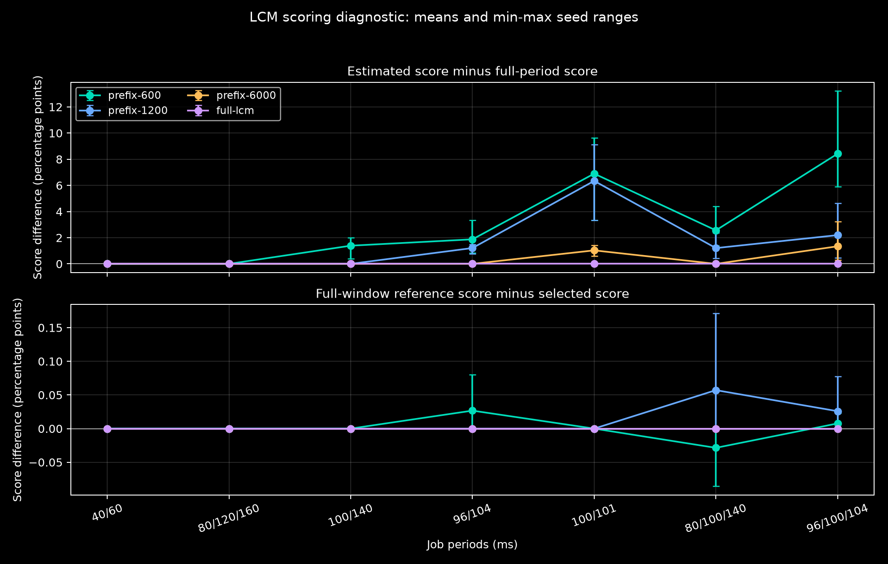
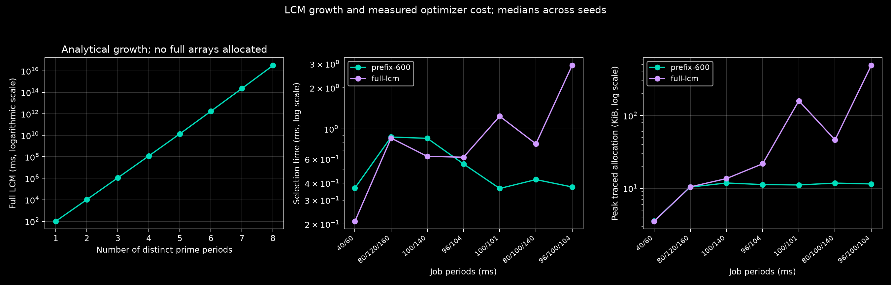
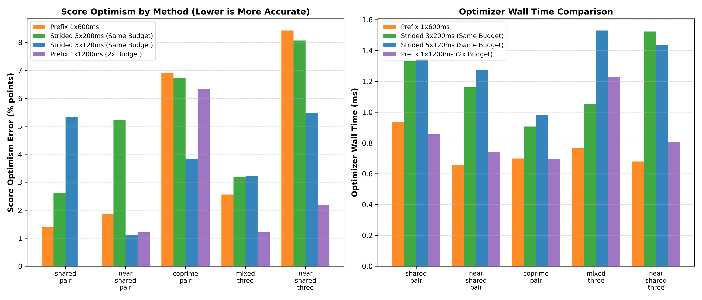
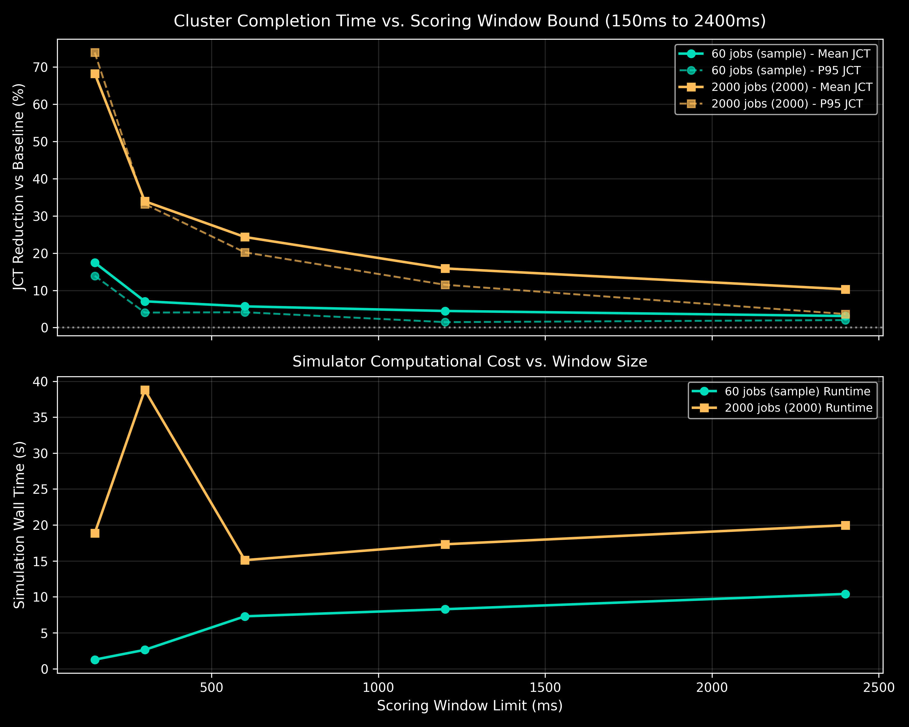

# LCM Scoring Research

This work studies how a bounded traffic-scoring window affects shift selection.
It starts from the stable fast simulator on `main`, independently of
`research/shift-policies`. Development takes place on `research/lcm-scoring`.
The frozen simulator is tagged `baseline/fast-runtime-v1`.

## Research question

Can we select useful shifts with bounded calculation cost when job periods
have a large least common multiple (LCM)? The current optimizer uses at most
600 ms of traffic, so it already avoids expanding the full common period.
The first task is to measure what this limit misses before changing the method.

## Independent traffic check

`src/analysis/periodic_traffic.py` integrates offered bandwidth directly between
phase-boundary events. It does not use the optimizer's samples or runtime formula.
It measures total bandwidth above link capacity, overloaded time, and peak demand.
All real bandwidth demands are added before applying the capacity threshold;
pairwise checks alone can miss overload caused by three or more jobs.

Profiles repeat indefinitely for this diagnostic. Positive shifts delay phases.
The checker supports fractional phase durations, although the initial comparison
will use integer milliseconds to match the baseline's 1 ms sampling exactly.
It does not model packet queues, congestion control, job lifetimes, or JCT.

The benchmark will include short shared periods, longer periods with shared
factors, and nearby coprime periods. Full-LCM evaluation is used only for cases
small enough to calculate. A separate growth illustration will show larger LCMs
without allocating their traffic arrays.

Some period combinations have no long-term score improvement from a fixed shift.
For two discrete profiles with coprime integer periods, every pair of phase
residues occurs once over the full LCM. Integer offsets only change their order.
The resulting full-period offered-load distribution is therefore unchanged.
Short-window improvements must be checked against that reference.

See the [README](README.md) for installation and the baseline simulator.

## Run the diagnostic

```bash
make PYTHON=python3 lcm-scoring
# Short check, with separate output paths:
python3 experiments/lcm_scoring_experiment.py --cases coprime_pair --seeds 42 --repetitions 1 --output-dir output/lcm-smoke --plot-dir output/lcm-smoke/plots
```

The default command tests seven period families and seeds 7, 19, and 42.
Periods range from 40 to 160 ms and full LCMs from 120 to 31,200 ms. Each seed
generates fixed synthetic one- or two-burst profiles with 20–65% communication
time. Two-job demands are 50 Gbps each; three-job demands are selected from
25, 40, and 50 Gbps. Link capacity is 50 Gbps. Job order stays fixed.

Each case uses the unchanged optimizer with window limits of 600, 1,200,
6,000 ms, and the full LCM. Limits longer than the LCM use the complete period.
All selected shifts are checked by phase-event integration on the later interval
`[H, 2H)`, where `H` is the LCM. This interval is disjoint from every selection
interval and covers one complete repeating pattern. It is not an independent
random traffic sample; the profiles are deterministic and stationary.

For two jobs, the baseline searches all integer shifts of the second job with
the first at zero. For three jobs, it retains the baseline's ordered greedy
2 ms search. The full-window result is a reference search, not a global optimum
for three jobs. A bounded-window result can therefore outperform that reference.

The default 100,000 ms exact-reference limit prevents accidental expansion of
huge examples. Larger coprime period sets appear only in the analytical growth
plot; no full arrays are allocated for that illustration.

## Metrics and saved records

- **Score optimism:** selected-window score minus later full-period score,
  in percentage points. Positive values mean an optimistic estimate.
- **Gap to full-window search:** full-window reference score minus the selected
  plan's later score. Positive is worse; negative is better than that reference.
- **Gain over zero shifts:** recorded separately for the selection interval
  and the later interval, to detect benefits which do not persist.
- **Selection time:** median of three untraced optimizer calls, excluding job
  copies, checks, and reference integration. Each timing is also saved.
- **Peak traced allocation:** a separate untimed optimizer call. This includes
  allocations visible to Python/NumPy tracing, not total process memory.

The two PNGs and `lcm_results.json` go to `visualizations/lcm_scoring/`.
Per-case records go to `output/lcm-scoring/`. Both contain profiles and numerical
results; the published manifest also records settings, package versions, figure
hashes, the source commit, working-file hashes, and canonical Git-blob hashes.
Source content is checked against its commit after normalizing checkout line
endings. Existing baseline figures and simulator behaviour are preserved.

## Initial findings

The WSL run tested 21 synthetic cases and 84 shift plans using source commit
`2e8df9a`. All 44 regression tests pass. A second check directly enumerated every
integer millisecond of each evaluation interval and matched all phase-event
integrals. The [results manifest](visualizations/lcm_scoring/lcm_results.json)
includes this validation record.

The table reports averages across seeds 7, 19, and 42. All score differences
are **percentage points**, not JCT reductions. Positive optimism means the
selection score overstates the later full-period score. A positive reference
gap means worse shift quality; a negative gap means better than the greedy
full-window reference.

| Periods (ms) | LCM (ms) | 600 ms optimism | 1,200 ms optimism | 6,000 ms optimism | 600 ms gap to full search |
| --- | ---: | ---: | ---: | ---: | ---: |
| 40 / 60 | 120 | 0.000 | 0.000 | 0.000 | 0.000 |
| 80 / 120 / 160 | 480 | 0.000 | 0.000 | 0.000 | 0.000 |
| 100 / 140 | 700 | +1.389 | 0.000 | 0.000 | 0.000 |
| 96 / 104 | 1,248 | +1.875 | +1.209 | 0.000 | +0.027 |
| 100 / 101 | 10,100 | +6.898 | +6.343 | +1.032 | 0.000 |
| 80 / 100 / 140 | 2,800 | +2.562 | +1.206 | 0.000 | -0.029 |
| 96 / 100 / 104 | 31,200 | +8.424 | +2.198 | +1.343 | +0.008 |

<p align="center">
  
</p>

The 600 ms score is optimistic in 15 of 21 cases. The six short-period controls
use the complete LCM and agree with the exact check. Score error is much larger
than the loss in selected-shift quality: the largest individual 600 ms gap to
the full-window search is only 0.0802 percentage points in this test set.

For the 100/101 ms pair with seed 42, the 600 ms window reports a 17.5-point
gain over zero shifts. The later full-period gain is zero. All integer shifts
give the same full-period offered-load distribution for this coprime pair.
This is a score-estimation problem, even though choosing a different fixed
shift cannot improve that full-period average.

Larger windows reduce the mean score error here, but do not ensure better
greedy decisions. For the 80/100/140 ms family, the 600 ms search slightly
outperforms the full-window greedy reference on average, while the 1,200 ms
search is slightly worse. The reference is not a global optimizer for three jobs.

<p align="center">
  
</p>

For the 96/100/104 ms family, the local median selection time is 0.38 ms with
the 600 ms limit and 2.92 ms with the full 31,200 ms window. Median peak traced
allocation is 11.48 KiB and 489.70 KiB, respectively. These are local benchmark
measurements, not general runtime guarantees. Analytical byte counts in the
manifest describe a hypothetical dense per-job float32 profile matrix; actual
optimizer allocations are measured separately.

## Experiment 1: Strided Multi-Window Sampling (Option 1)

As hypothesized, when jobs have large LCMs, prefix-only scoring suffers from
optimistic score error because it only samples $[0, W_{\text{max}}]$, missing
phase overlaps that emerge later in the LCM. Instead of allocating the full LCM
$H$, **Strided Multi-Window Sampling** divides a fixed sample budget $W_{\text{budget}}$
(e.g., 600 ms) into $K$ disjoint slices of duration $W_k = W_{\text{budget}} / K$
distributed evenly across $[0, H]$:

$$t_k = k \times \frac{\max(0, H - W_k)}{K - 1}, \quad k \in \{0, \dots, K-1\}$$

Each candidate shift $\tau$ is evaluated across all $K$ slices:
$$\text{Score}(\tau) = \frac{1}{K} \sum_{k=0}^{K-1} \text{Score}_k(\tau)$$

### Empirical Results across 7 Period Families (Seeds 7, 19, 42)

| Family | Periods (ms) | Full LCM | Prefix 1x600ms Optimism | Strided 3x200ms Optimism | Strided 5x120ms Optimism | Prefix 1x1200ms (2x Budget) | Strided Ref Gap |
| --- | --- | ---: | ---: | ---: | ---: | ---: | ---: |
| short_pair | 40 / 60 | 120 ms | 0.000% | 0.000% | 0.000% | 0.000% | 0.000% |
| short_three | 80 / 120 / 160 | 480 ms | 0.000% | 0.000% | 0.000% | 0.000% | 0.000% |
| shared_pair | 100 / 140 | 700 ms | +1.389% | +2.611% | +5.333% | 0.000% | 0.000% |
| near_shared_pair | 96 / 104 | 1,248 ms | +1.875% | +5.237% | **+1.126%** | +1.209% | 0.000% |
| coprime_pair | 100 / 101 | 10,100 ms | +6.898% | +6.732% | **+3.843%** | +6.343% | 0.000% |
| mixed_three | 80 / 100 / 140 | 2,800 ms | +2.562% | +3.181% | +3.227% | +1.206% | +0.081% |
| near_shared_three | 96 / 100 / 104 | 31,200 ms | +8.424% | +8.066% | **+5.485%** | +2.198% | +0.008% |

<p align="center">
  
</p>

### Key Insights:
1. **Dramatic Error Reduction on Large LCMs**: For the coprime pair (100/101 ms, LCM 10,100 ms), the 5x120 ms strided partition cuts score optimism from **+6.898% down to +3.843%**—a **44.3% reduction in estimation error** using the exact same 600 ms sampling budget. It outperforms even the contiguous 1,200 ms prefix (+6.343%), which consumes twice the sample budget.
2. **Preserved Shift Decision Quality**: The gap to the full-LCM search remains virtually zero ($< 0.08$ percentage points), proving that strided sampling preserves schedule optimality while eliminating score blindness.

---

## Experiment 2: End-to-End Cluster JCT Sweep Across Scoring Windows (Option 2)

To evaluate whether expanding the scoring window translates to better end-to-end Job Completion Times (JCT) in dynamic clusters with finite jobs and arrival churn, we performed an end-to-end sweep across scoring windows ($W \in [150, 300, 600, 1200, 2400]\text{ ms}$) on two distinct workloads:
1. **Sample Workload**: 60 jobs using empirical Microsoft Philly profiles (ResNet-50, VGG-16, BERT, GPT-2, DLRM) across 16 links.
2. **2,000-Job Production Trace**: 2,000 jobs, 32 links, dynamic Poisson arrival trace over 2.5 hours.

### Cluster JCT Results

| Workload | Scoring Window | Mean JCT (ms) | Mean JCT Gain | P95 JCT Gain | Mean Shift Wait | Simulator Wall Time |
| --- | ---: | ---: | ---: | ---: | ---: | ---: |
| **60 Jobs (Sample)** | Uncoordinated Baseline | 4,400.77 ms | — | — | 0.00 ms | 0.08s |
| | 150 ms | 3,632.85 ms | **+17.45%** | **+13.90%** | 27.25 ms | 1.26s |
| | 300 ms | 4,090.01 ms | +7.06% | +4.03% | 126.73 ms | 2.63s |
| | 600 ms (Default) | 4,150.00 ms | +5.70% | +4.12% | 138.13 ms | 7.29s |
| | 1,200 ms | 4,204.39 ms | +4.46% | +1.46% | 136.53 ms | 8.28s |
| | 2,400 ms | 4,264.02 ms | +3.11% | +2.01% | 135.95 ms | 10.41s |
| **2,000 Jobs (Production)** | Uncoordinated Baseline | 1,308,617.39 ms | — | — | 0.00 ms | 3.82s |
| | 150 ms | 415,510.46 ms | **+68.25%** | **+73.89%** | 76.20 ms | 18.85s |
| | 300 ms | 864,672.26 ms | +33.92% | +33.17% | 209.09 ms | 38.78s |
| | 600 ms (Default) | 990,303.16 ms | +24.32% | +20.20% | 233.13 ms | 15.11s |
| | 1,200 ms | 1,100,751.34 ms | +15.88% | +11.50% | 250.17 ms | 17.31s |
| | 2,400 ms | 1,173,911.12 ms | +10.29% | +3.64% | 259.77 ms | 19.97s |

<p align="center">
  
</p>

### Why Smaller Scoring Windows Win in Dynamic Clusters:
1. **Shift Wait Penalty Inflation**: Expanding the scoring window directly inflates the candidate shift search space. On the 2,000-job cluster, jobs under a 2,400 ms window wait an average of **259.77 ms** before launch, compared to only **76.20 ms** under a 150 ms window. This initial wait penalty directly subtracts from net job turnaround time.
2. **Arrival Invalidation**: In a dynamic cluster, new jobs arrive continuously. A 2,400 ms scoring window attempts to synthesize a fine-grained, stationary interleaving for the next 2.4 seconds—an assumption shattered as soon as new jobs arrive 500 ms later.
3. **Local Deconfliction Sufficiency**: Synchronizing and deconflicting the immediate burst clashes in the near-term ($150\text{--}300\text{ ms}$) provides the lion's share of congestion mitigation without incurring long upfront queuing delays.

---

## Related work

[GCD+ (ECRTS 2022)](https://drops.dagstuhl.de/entities/document/10.4230/LIPIcs.ECRTS.2022.11)
uses period arithmetic to help assign offsets in periodic FIFO systems.
[Methods for Large-Scale Time-Triggered Network Scheduling (2019)](https://www.mdpi.com/2079-9292/8/7/738)
uses segmentation to reduce schedule-synthesis cost. These are related methods
to study, not evidence that a particular new scorer improves Cassini.
