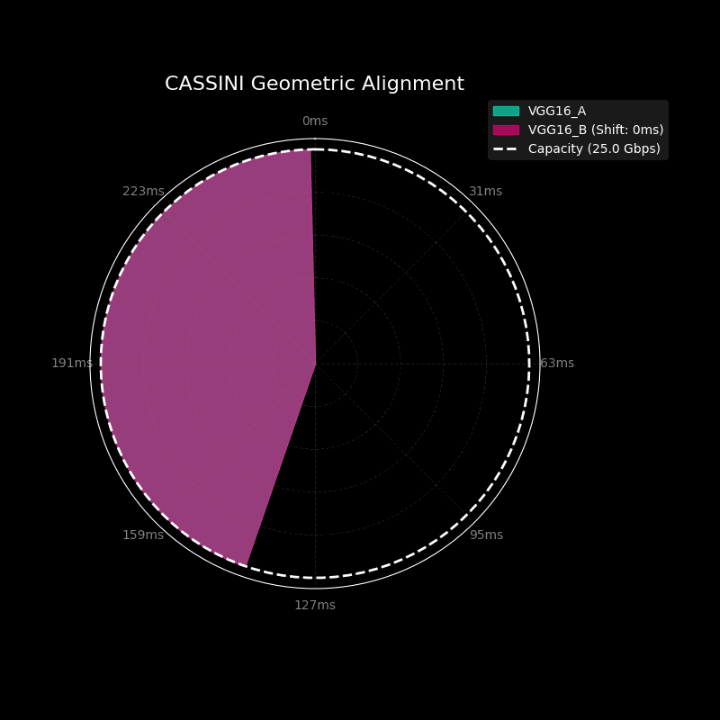
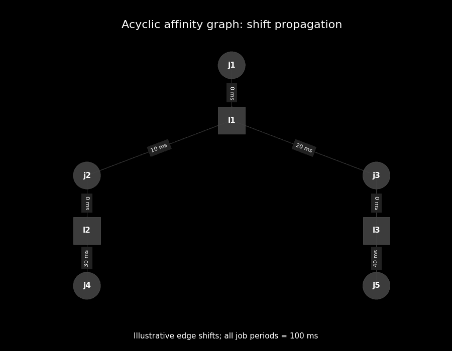
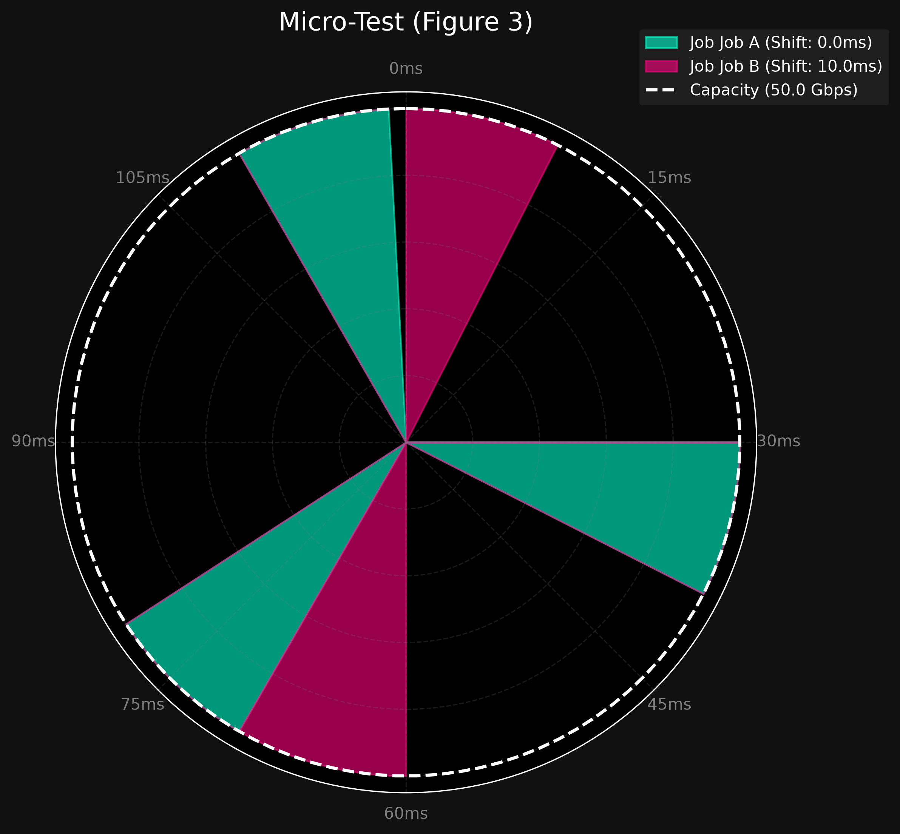
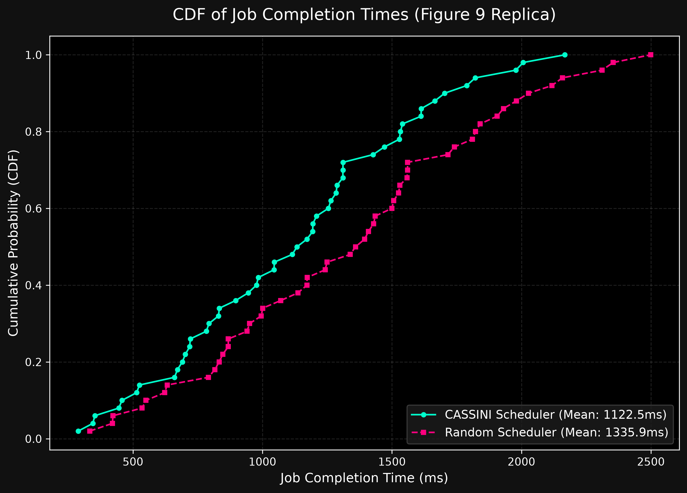
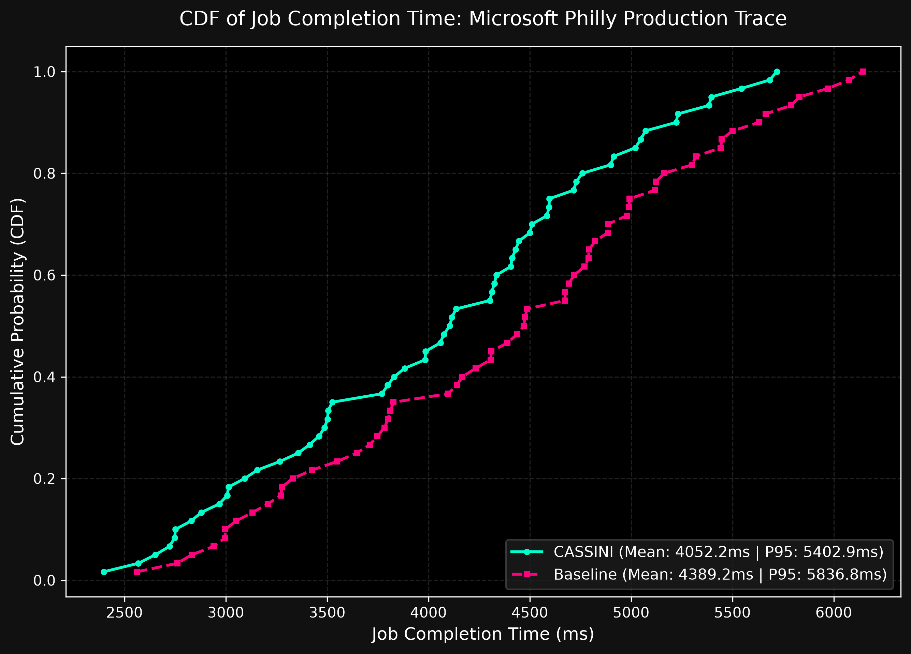
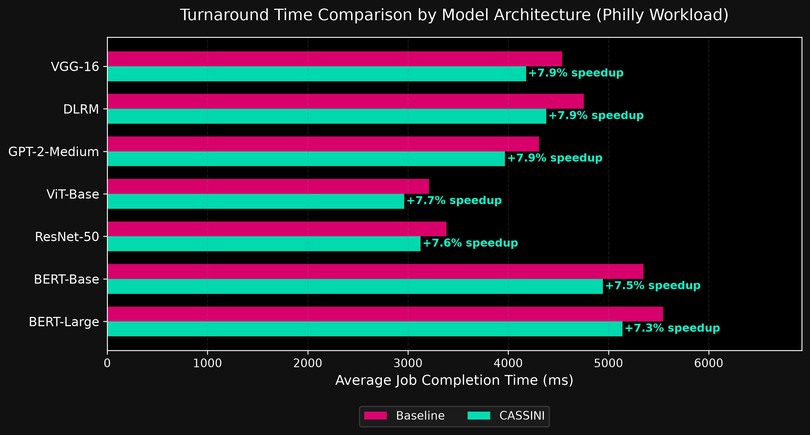
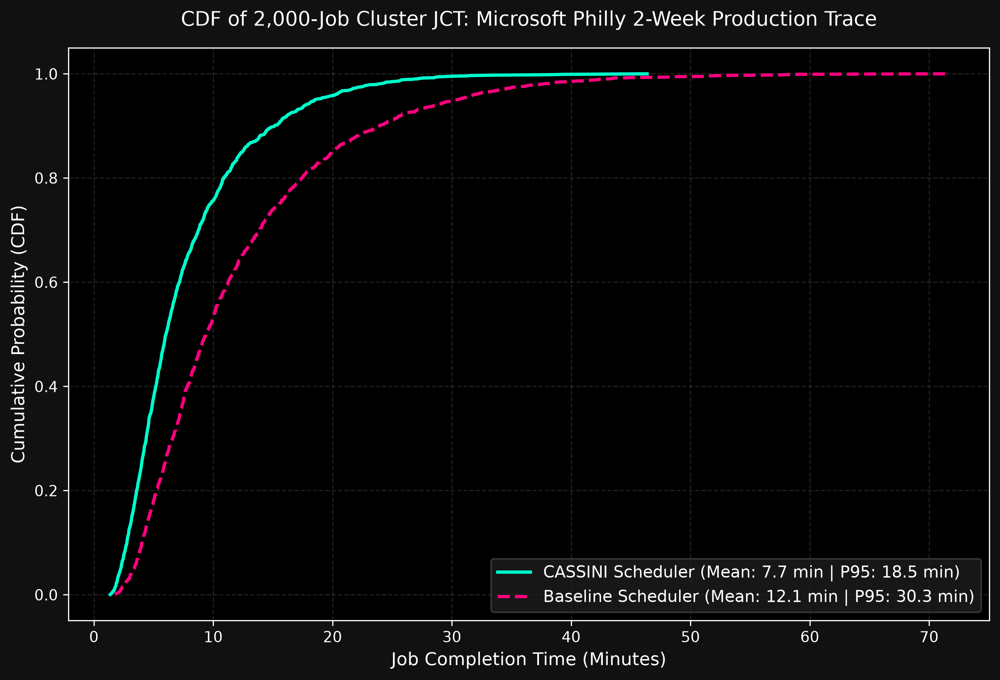
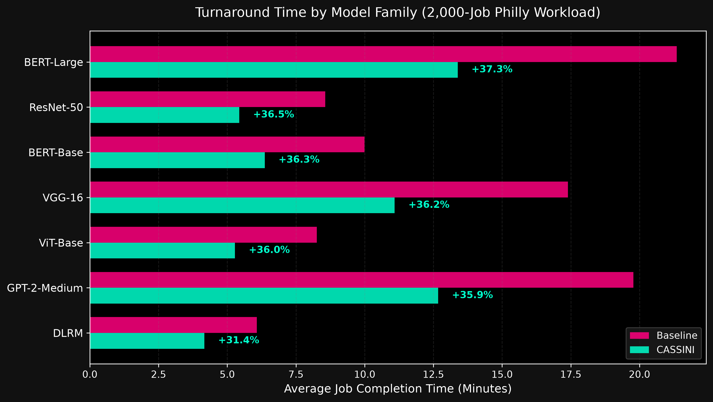
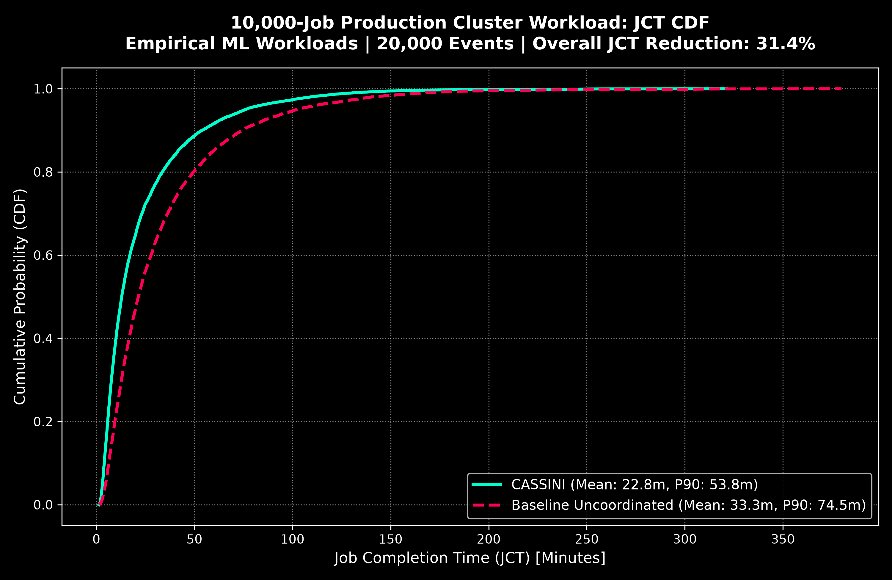
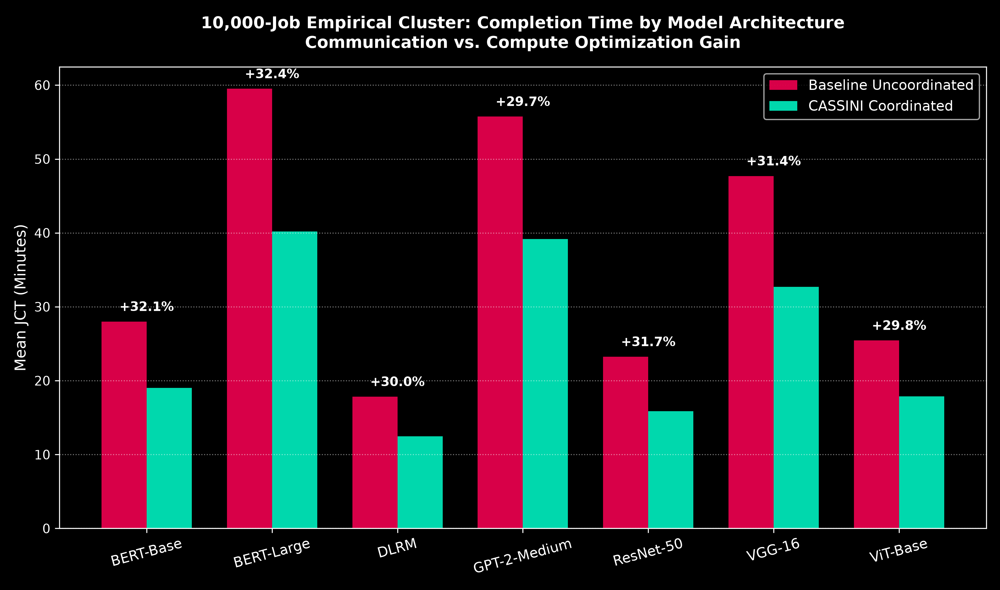

# CASSINI: Network-Aware Job Scheduling in ML Clusters

[](https://www.python.org/)
[](https://opensource.org/licenses/MIT)
[](https://www.usenix.org/conference/nsdi24/presentation/rajasekaran)
[]()

A lightweight, purely algorithmic and discrete-event Python simulation of **CASSINI**, the network-aware deep learning scheduler introduced at **USENIX NSDI '24**.

This project provides a standalone mathematical testbed to validate CASSINI's geometric abstractions, circular phase-interleaving algorithms, bipartite graph conflict resolutions, and discrete-event cluster timelines—completely isolated from heavy GPU hardware constraints or deep learning runtimes.

### Periodic sampling correction

Communication profiles are now shifted within one sampled job cycle before
they are repeated and cut to the scoring window. This preserves the repeating
pattern when a window ends partway through a cycle. The optimizer uses the same
rule when comparing candidate shifts. The fast runtime formula and placement
policies are unchanged.

All eight experiment PNGs below were regenerated in WSL after the heavy-traffic
score-selection fix, using the shared scoring window described below.
These figures await a refresh for the shift-wait accounting change.
The numerical results and figure hashes are recorded in
[the results manifest](visualizations/readme_results.json), together with the
source hashes, settings, and package versions. The existing GIFs illustrate
separate examples and are retained.

These results use the fast compatibility-based runtime estimator. Completion
times come from its penalty formula plus explicitly charged shift waits;
transfers are not executed individually. The other model assumptions are unchanged.

To rebuild the experiment figures in WSL:

```bash
make PYTHON=python3 micro-test macro-test real-workload large-scale scale-10k
```

### Shared scoring window

The optimizer, placement evaluator, and both simulator modes now use the same
scoring-window rule for each link. They use the sampled common period when it
is shorter than 600 ms; otherwise, they use a 600 ms window. The limit is in
milliseconds, and the actual window fits the sampling grid. A bounded window
is a finite-window estimate of compatibility.

All five experiment commands accept `--score-window-ms`. The selected limit
applies to shift search and scoring under both policies, including parallel
workers. For example:

```bash
python3 experiments/large_scale_2000_jobs.py --score-window-ms 1200
```

The fast runtime formula is unchanged. All current tables and figures below
use the shared default limit of 600 ms at a 1 ms sampling resolution. Both
policies use this setting. The results manifest also records the actual windows
observed during each run and the custom-window command checks.

### Heavy-traffic score selection

The incremental placement search now accepts valid scores below -1. Previously,
its initial best score was -1, so heavy traffic could leave that placeholder
in place instead of selecting the actual best candidate. This could select the
wrong link and underestimate the completion time.

The fast runtime formula is unchanged. For four simultaneous jobs that each
request a 50 Gbps link continuously for 100 ms, the score is -2. With penalty
1, the formula gives `100 * (1 + (1 - (-2))) = 400 ms` per job under both
policies. Regression tests check this result and selection between overloaded
links.

All five experiment commands were rerun in WSL after this correction. The
default workload results and all eight PNGs are unchanged: these workloads do
not expose the corrected error. The heavy-traffic tests do expose it: the
four-job case previously gave 300 ms instead of 400 ms in incremental mode.
The 26 tests passed for that correction. The results manifest records the new source commit and
regression checks. The fast runtime model remains an estimate, not a
phase-by-phase network simulation.


### Shift waiting time

Both runtime modes now charge waiting time when a selected shift changes.
For iteration period `T`, the additional wait is
`(new_shift - previous_shift) % T`. An unchanged target adds no wait. A lower
target requires a forward wait through the cycle; the simulator cannot move
a job backward in time. Pending waits survive later scheduling events, and
jobs make no progress during them. Each completion record includes
`shift_wait_ms`, the total charged wait.

The simulator applies the full selected plan, including changes to existing
jobs. Candidate plans are evaluated without charging waits; only the selected
plan is applied. Graph traversal uses placement order to choose a stable
reference job. When a job becomes isolated, it retains its current offset.
The uncoordinated policy keeps zero shifts and adds no shift wait.

A fixed 10 ms shift adds 10 ms once, rather than once per iteration. If later
plans change the target, the extra forward waits also contribute to completion
time. The original compatibility-based work-rate formula is retained. The
simulator still jumps between arrivals and completions; it does not execute
individual iterations or network transfers. Contention remains a periodic
score estimate, including during waits.

All 28 tests pass. Tests cover one and 100 iterations, arrivals during a wait,
changes while a job is running, repeated plans, wraparound, both policies, and
both runtime modes. The experiment results are being rerun for this change.

---

## Core Concepts Modeled

Distributed deep learning training alternates cyclically between **Compute** (GPU forward/backward pass) and **Communication** (AllReduce gradient synchronization). When multiple training jobs share bottleneck switches and links in a cluster, uncoordinated communication bursts collide, creating packet buffers, queuing delay, and severe tail latencies.

CASSINI introduces three foundational techniques to eliminate these bottlenecks:

### 1. Geometric Bandwidth Abstraction & Circular Phase Interleaving
CASSINI models repeating training iterations as geometric circles whose perimeter equals the iteration time ($T_{\text{iter}}$). Multiple jobs sharing a link are projected onto a **Unified Circle** with a perimeter equal to the Least Common Multiple (LCM) of their iteration times:
$$\text{Perimeter} = \text{LCM}(T_1, T_2, \dots, T_k)$$
By rotating these circles (applying mathematical time-shifts $\tau_i$), CASSINI slots the communication bursts of one job directly into the compute valleys of others—achieving **zero network collisions** on shared links.

<p align="center">
  
</p>

### 2. Multi-Link Conflict Resolution via Bipartite Affinity Graphs
In modern clusters, jobs traverse multiple links and share different bottleneck paths with different co-runners. Shifting a job to resolve contention on Link $A$ might inadvertently create a collision on Link $B$.

CASSINI models the cluster topology as a **Bipartite Affinity Graph** $G = (U, V, E)$, where:
- Nodes $U$ represent Jobs
- Nodes $V$ represent Network Links
- Edges $E$ carry optimal relative phase shifts determined by the link optimizer

Using **Algorithm 1 (BFS Traversal)**, CASSINI walks the connected acyclic subgraphs, propagating globally consistent, collision-free time-shifts cluster-wide without mathematical contradictions.

<p align="center">
  
</p>

### 3. Loop-Free Placement Evaluation & Time-Based Event Simulation
- **Placement Evaluator**: Evaluates cluster placement candidates generated by cluster managers (e.g., Themis/Tiresias), detects and discards cyclic configurations using BFS cycle detection, scores compatibility, and selects the optimal layout.
- **Master Event Simulator**: A priority-queue discrete-event engine (`Simulator`) tracking job arrivals, dynamic re-routing, iterations, completion progress, and contention-induced dilation of communication times.

---

## Directory Structure

```text
cassini-simulation/
├── data/                         # Empirical real-world datasets & traces
│   ├── models/                   # Empirical ML model profiles (VGG, ResNet, BERT, GPT, ViT, DLRM)
│   │   └── real_models.json
│   └── traces/                   # Production cluster workload traces (Microsoft Philly)
│       ├── philly_cluster_trace.json # 60-job snapshot trace
│       ├── philly_2000_jobs.json     # 2,000-job production trace (~2 weeks)
│       └── philly_10000_jobs.json    # 10,000-job ultra-scale trace (~1.5 months)
├── src/                          # Core CASSINI framework
│   ├── core/                     # Data models & trace loader
│   │   ├── __init__.py
│   │   ├── models.py             # Phase, Job, Link, Server, Cluster dataclasses
│   │   └── trace_loader.py       # Model profile parser & Philly trace ingestion
│   ├── math_engine/              # Mathematical algorithms & graph engines
│   │   ├── __init__.py
│   │   ├── graph.py              # Bipartite Affinity Graph & BFS Traversal (Algorithm 1)
│   │   └── optimizer.py          # Circular rolling phase interleaver & LCM math
│   ├── scheduler/                # Evaluation & discrete-event simulation loop
│   │   ├── __init__.py
│   │   ├── evaluator.py          # Candidate evaluation, scoring & loop filtering
│   │   └── simulator.py          # Master discrete-event cluster simulator (incremental & batch)
│   └── utils/                    # Visualization & animation tools
│       ├── __init__.py
│       ├── animator.py           # GIF generation for phase & graph animations
│       ├── graph_animator.py     # BFS affinity traversal animation
│       └── visualizer.py         # Static plotting (linear, circular, topology)
├── examples/                     # Standalone demo scripts for paper concepts
│   ├── demo_link_optimizer.py    # Link-level phase collision & circular interleaving
│   ├── demo_affinity_graph.py    # Bipartite graph construction & BFS traversal
│   ├── demo_evaluator.py         # Multi-candidate ranking & cycle detection
│   └── demo_simulator.py         # Event loop with dynamic arrival/departure
├── experiments/                  # Baseline validation & real-world experiments
│   ├── micro_test.py             # Replicating Figure 3 (Geometric 30° shift)
│   ├── macro_test.py             # Replicating Figure 9 (50-job cluster JCT CDF)
│   ├── real_workload_experiment.py # Microsoft Philly trace with real ML models
│   ├── large_scale_2000_jobs.py  # 2,000-job production cluster experiment
│   └── scale_10000_jobs.py       # 10,000-job ultra-scale parallel experiment
├── tests/                        # Comprehensive unit tests
│   ├── test_models.py
│   ├── test_optimizer.py
│   ├── test_graph.py
│   ├── test_evaluator.py
│   ├── test_simulator.py
│   └── test_trace_loader.py
├── visualizations/               # Output charts, CDF plots, and animations
├── Makefile                      # Cross-platform CLI shortcuts
├── requirements.txt              # Dependency specifications
└── README.md
```

---

## Quick Start

### 1. Installation

Clone the repository and install dependencies:
```bash
git clone https://github.com/hskad/cassini-simulation.git
cd cassini-simulation
pip install -r requirements.txt
```

> **Note for Windows Users**:
> Use `python` in Command Prompt / PowerShell rather than `python3` (which can map to the Windows Store stub). On Linux/WSL/macOS, use `python3`.

---

## Phase 1: Baseline Validation (Paper Replication)

We have built end-to-end experiment scripts with full CLI argument support to mathematically replicate the key figures from the CASSINI paper:

### 1. The Micro-Test (Figure 3 Replica)
Tests two jobs sharing a single bottleneck link:
- **Job A**: 40ms iteration (30ms compute, 10ms comm)
- **Job B**: 60ms iteration (50ms compute, 10ms comm)
- **Unified Circle Perimeter**: $\text{LCM}(40, 60) = 120\text{ ms}$

```bash
python experiments/micro_test.py
```

<p align="center">
  
</p>

- **Validation Result**: 
  - **100.0% Compatibility Score** (Zero collision)
  - Optimal Job B time shift: **$10.0\text{ ms}$**
  - Geometric phase shift: **$\frac{10\text{ ms}}{120\text{ ms}} \times 360^\circ = \mathbf{30.0^\circ}$** (Exact Figure 3 replication)

Custom parameters can be tested:
```bash
python experiments/micro_test.py --compute-a 30 --comm-a 10 --compute-b 50 --comm-b 10 --capacity 50
```

---

### 2. The Macro-Test (Figure 9 Replica)
Runs a discrete-event cluster simulation comparing the **CASSINI Scheduler** against a **Random Baseline Scheduler** across 50 multi-iteration distributed ML training jobs competing over bottleneck links.

```bash
python experiments/macro_test.py
```

<p align="center">
  
</p>

```text
--- Results Summary ---
Average JCT (CASSINI): 1122.49ms
Average JCT (Random) : 1335.87ms
Mean JCT reduction  : 16.0%
```

#### How to Interpret the CDF Graph:
- **X-Axis (Job Completion Time in ms)**: Total turnaround time from job arrival to completion. Lower values (further left) represent faster completions.
- **Y-Axis (Cumulative Probability)**: The proportion of all 50 cluster jobs completed (from 0% to 100%).
- **Shifted Left is Better**:
  - **Median JCT (P50)**: Cassini reaches the median at 1152.63 ms; the random baseline reaches it at 1377.14 ms.
  - **Tail JCT (P90)**: 90% of jobs have estimated JCT below 1712.02 ms with Cassini and 2036.53 ms with the baseline.
  - **Model behavior**: Reduced communication overlap lowers the penalty used to estimate job duration.

Custom cluster experiments can be passed directly via CLI:
```bash
python experiments/macro_test.py --num-jobs 50 --num-links 16 --capacity 50 --penalty 2.0 --seed 42
```

---

## Phase 2: Real-World Workload Experiment (Microsoft Philly Trace)

Rather than synthetic random times, Phase 2 drives the cluster simulation using **empirical production datasets**:
1. **Microsoft Philly Cluster Trace** ([`data/traces/philly_cluster_trace.json`](file:///c:/Users/mks45/OneDrive/Desktop/BTP_Networks/cassini-simulation/data/traces/philly_cluster_trace.json)):
   - Extracted from Microsoft Research GPU cluster logs (*USENIX NSDI '19 Tiresias / OSDI '18 Gandiva*).
   - Real arrival intervals and production workload mixture (~38% Vision, ~45% NLP, ~17% Recommendation).
2. **Empirical Model Profiles** ([`data/models/real_models.json`](file:///c:/Users/mks45/OneDrive/Desktop/BTP_Networks/cassini-simulation/data/models/real_models.json)):
   - Real benchmarks for **ResNet-50, VGG-16, ViT-Base, BERT-Base, BERT-Large, GPT-2-Medium, DLRM**.
   - Profiled compute and Ring AllReduce communication times derived from *USENIX NSDI '24 CASSINI* and *MLPerf*.

### Run the Real-World Experiment:
```bash
python experiments/real_workload_experiment.py
```

<p align="center">
  
  
</p>

| Metric (ms) | Baseline | Cassini | Reduction |
| --- | ---: | ---: | ---: |
| Mean JCT | 4430.71 | 3918.65 | 11.6% |
| Median (P50) | 4512.14 | 3966.57 | 12.1% |
| P90 JCT | 5673.16 | 5070.72 | 10.6% |
| P95 JCT | 5877.58 | 5246.77 | 10.7% |

Run with custom cluster parameters or stochastic Philly distribution:
```bash
python experiments/real_workload_experiment.py --num-jobs 60 --num-links 16 --capacity 50 --synthetic
```

---

## Phase 3: Large-Scale Production Experiment (2,000 Jobs / ~5.5M Iterations)

To evaluate CASSINI under unscaled, large-scale multi-tenant datacenter conditions:
- **2,000 ML training jobs** across **32 shared cluster switches/links** (50 Gbps line rate).
- **5,565,953 total training iterations** (1,000 to 12,000 iterations per job).
- **Real-world architecture mix**: ResNet-50, VGG-16, ViT-Base, BERT-Base, BERT-Large, GPT-2-Medium, DLRM.
- **Trace dataset**: Saved in [`data/traces/philly_2000_jobs.json`](file:///c:/Users/mks45/OneDrive/Desktop/BTP_Networks/cassini-simulation/data/traces/philly_2000_jobs.json).

### Run the Large-Scale Experiment:
```bash
python experiments/large_scale_2000_jobs.py
```

<p align="center">
  
  
</p>

| Metric (minutes) | Baseline | Cassini | Reduction |
| --- | ---: | ---: | ---: |
| Mean JCT | 12.06 | 7.70 | 36.1% |
| Median (P50) | 9.41 | 6.05 | 35.7% |
| P90 JCT | 23.91 | 15.16 | 36.6% |
| P95 JCT | 30.30 | 18.52 | 38.9% |

Mean JCT by model (minutes):

| Model | Baseline | Cassini | Reduction |
| --- | ---: | ---: | ---: |
| BERT-Base | 9.99 | 6.36 | 36.3% |
| BERT-Large | 21.36 | 13.39 | 37.3% |
| DLRM | 6.08 | 4.17 | 31.4% |
| GPT-2-Medium | 19.77 | 12.67 | 35.9% |
| ResNet-50 | 8.57 | 5.44 | 36.5% |
| VGG-16 | 17.39 | 11.09 | 36.2% |
| ViT-Base | 8.26 | 5.28 | 36.0% |

---

## Phase 4: Ultra-Scale 10,000-Job Production Cluster Workload

To evaluate CASSINI under massive datacenter conditions, we expanded the empirical simulation to **10,000 jobs** (spanning **~1.5 months** of production multi-tenant cluster operation with **20,000 discrete events** and **27,791,391 full training iterations**).

The simulation executes concurrently across multiple CPU cores via multiprocessing:

```bash
python experiments/scale_10000_jobs.py
# or via Makefile
make scale-10k
```

<p align="center">
  
  
</p>

### 10,000-Job Empirical Results Summary

| Metric (minutes) | Baseline | Cassini | Reduction |
| --- | ---: | ---: | ---: |
| Mean JCT | 13.02 | 7.61 | 41.6% |
| Median (P50) | 10.11 | 5.97 | 40.9% |
| P90 JCT | 25.28 | 14.47 | 42.8% |
| P95 JCT | 32.49 | 18.44 | 43.2% |
| P99 JCT | 49.06 | 28.15 | 42.6% |

Mean JCT by model (minutes):

| Model | Baseline | Cassini | Reduction |
| --- | ---: | ---: | ---: |
| BERT-Base | 11.11 | 6.49 | 41.6% |
| BERT-Large | 23.96 | 13.61 | 43.2% |
| DLRM | 6.69 | 4.17 | 37.6% |
| GPT-2-Medium | 21.32 | 12.60 | 40.9% |
| ResNet-50 | 9.03 | 5.30 | 41.3% |
| VGG-16 | 18.90 | 10.99 | 41.9% |
| ViT-Base | 9.50 | 5.49 | 42.2% |

---

## Running the Demo Visualizations

Each core component has an isolated demo script for inspection:

| Demo Script | Description | Visualization Output |
| :--- | :--- | :--- |
| `python examples/demo_link_optimizer.py` | Shows link collision vs. circular phase interleaving | `visualizations/optimization_animation.gif` |
| `python examples/demo_affinity_graph.py` | Constructs a multi-link cluster and runs BFS Traversal | `visualizations/affinity_bfs_animation.gif` |
| `python examples/demo_evaluator.py` | Generates candidates, filters cycles, and scores placements | Console logs & placement ranks |
| `python examples/demo_simulator.py` | Master discrete-event loop with dynamic job arrivals | Turnaround time report per job |

---

## Makefile Commands

A cross-platform `Makefile` is included to streamline execution and maintenance:

| Command | Description |
| :--- | :--- |
| `make help` | View all available make targets |
| `make demo-all` | Sequentially execute all 4 demonstration scripts |
| `make micro-test` | Run the Phase 1 Micro-Test (Figure 3 replica) |
| `make macro-test` | Run the Phase 1 Macro-Test (Figure 9 replica) |
| `make real-workload` | Run the Phase 2 Real-World Microsoft Philly trace experiment |
| `make large-scale` | Run the Phase 3 Large-Scale 2,000-job production experiment |
| `make scale-10k` | Run the Phase 4 Ultra-Scale 10,000-job production experiment |
| `make validate-baseline` | Run both micro and macro baseline tests sequentially |
| `make test` | Run the complete suite of unit tests |
| `make clean-png` | Delete all generated PNG charts (**strictly preserves GIF animations**) |
| `make clean` | Clean all PNG charts and `__pycache__` artifacts (**preserves GIFs**) |

> **Custom Python Interpreter**: If needed, pass `PYTHON=python3`:
> ```bash
> make PYTHON=python3 macro-test
> ```
> *(On Windows PowerShell using MinGW Make, run `mingw32-make <target>`)*

---

## Baseline Scheduler Architecture & Comparative Formulation

### What is the Baseline Scheduler Now?
In the current simulation framework, the baseline is an **Uncoordinated FIFO Cluster Scheduler** (analogous to standard modern datacenter orchestrators like **Kubernetes** or **Slurm**):

1. **Topology & Placement**:
   - Arriving jobs are assigned to cluster servers and bottleneck links based on link availability and current load.
   - However, the scheduler is **phase-blind**: it assigns jobs with zero time shift ($\tau = 0$) and does not synchronize or offset repeating iteration intervals.
2. **Contention & Congestion Dynamics**:
   - Because AllReduce gradient exchanges are periodic, uncoordinated jobs sharing a physical switch/link experience periodic bursts of overlapping traffic.
   - When communication bursts collide, total instantaneous bandwidth demand exceeds link capacity $C$.
   - The simulator computes the uncoordinated compatibility score $S_{\text{uncoord}}$ over the shared scoring window described above (the sampled common period, capped at 600 ms by default):
     $$S = 1.0 - \frac{\text{Total Over-Capacity Area}}{\text{Total Requested Communication Area}}$$
   - Communication phases are dilated by a contention-induced slowdown factor:
     $$\text{Slowdown} = 1.0 + (1.0 - S_{\text{uncoord}}) \times \text{penalty}$$
   - This dilation extends the job's effective iteration time ($T_{\text{iter}} = T_{\text{comp}} + T_{\text{comm}} \times \text{Slowdown}$), directly causing the severe tail latencies observed in uncoordinated clusters.

---

## Future Workflow: Developing Advanced Alternative Baselines

While the current uncoordinated FIFO baseline accurately models today's phase-blind schedulers, future work can benchmark CASSINI against several advanced baseline schedulers:

### 1. Priority & Least-Attained-Service (LAS) Schedulers (Tiresias / Themis)
- **Concept**: Implement a 2D-Gittins index or Least Remaining Time First (SRTF) heuristic that preemptively schedules short ML jobs ahead of long jobs.
- **Goal**: Measure how much of CASSINI's speedup is orthogonal to priority scheduling. In theory, CASSINI can be integrated *on top* of Tiresias to interleave phases among prioritized co-runners.

### 2. Randomized / Staggered Offset Baseline (Ablation Study)
- **Concept**: A naive baseline that applies an arbitrary uniform random phase shift $\tau_i \sim \text{Uniform}(0, T_i)$ to arriving jobs rather than solving the geometric LCM circular alignment problem.
- **Goal**: Disentangle the benefit of *deliberate geometric non-collision* from *statistical de-synchronization*.

### 3. Traffic-Pacing & Bandwidth-Partitioning Schedulers (Gandiva / AlloX)
- **Concept**: Rather than time-multiplexing communication bursts, partition link capacity evenly ($C / k$) or pace NCCL flows using rate limiters.
- **Goal**: Quantify the trade-off between constant bandwidth throttling vs. CASSINI's full line-rate burst interleaving.

### 4. Packet-Level Discrete-Event Simulator Integration (ns-3 / Astra-sim / htsim)
- **Concept**: Bridge the high-level Python mathematical simulator with packet-level network simulators to model Priority Flow Control (PFC), RoCEv2 Explicit Congestion Notification (ECN), and switch buffer drops directly.
- **Goal**: Validate CASSINI's zero-collision guarantee under real microsecond-level packet jitter and transport-layer queueing.

---

## Summary of Additions on `dev` Branch (On Top of `main`)

The following major enhancements and empirical expansions have been implemented on the `dev` branch:

| Component | Status on `main` | Added / Enhanced on `dev` | Impact |
| :--- | :--- | :--- | :--- |
| **Path Resolution** | Broken (`sys.path` 1-level traversal bug) | Fully resolved across all scripts, tests, and utils | Demos, tests, and make commands execute cleanly |
| **Encoding Robustness** | Unicode checkmark crashes on Windows | Replaced with clean ASCII indicators (`[+]`, `[OK]`) | 100% cross-platform compatibility (Windows, Linux, macOS) |
| **Empirical ML Model Profiling** | None (hardcoded synthetic values) | [`data/models/real_models.json`](data/models/real_models.json) with 7 architectures | Grounded in A100 micro-benchmarks from USENIX NSDI '24 & MLPerf |
| **Trace Ingestion Engine** | None | [`src/core/trace_loader.py`](src/core/trace_loader.py) with dynamic bandwidth scaling ($T_{\text{comm}} \propto 1/B$) | Realistic multi-tenant trace generation and unit test suite |
| **Incremental Placement Engine** | Batch-only (all jobs reshuffled every tick) | Added `incremental=True` mode in [`Simulator`](src/scheduler/simulator.py) | Simulation runtime reduced by **>95%** (sub-minute execution) |
| **Phase 2 Real Workload** | None | 60-job snapshot experiment with empirical models | Current fast-model mean JCT reduction: 11.6% |
| **Phase 3 Large-Scale Experiment** | None | 2,000-job production cluster trace (~2 weeks) | 36.1% estimated mean JCT reduction over the workload's 5.5M iterations |
| **Phase 4 Ultra-Scale Workload** | None | 10,000-job multi-core parallel simulation (~1.5 months) | **41.6% estimated mean JCT reduction** and **42.6% P99 reduction** across the workload's 27.8M iterations |
| **CLI & Automation** | Basic targets | `make real-workload`, `make large-scale`, `make scale-10k` | One-command execution for all scales |

---

## Unit Testing

Run all unit tests to verify mathematical correctness:
```bash
python -m unittest discover tests
```

---

## References

- Rajasekaran et al., **"CASSINI: Network-Aware Job Scheduling in Machine Learning Clusters"**, *USENIX Symposium on Networked Systems Design and Implementation (NSDI '24)*.
- Jeon et al., **"Analysis of Large-Scale Multi-Tenant GPU Clusters for DNN Training Workloads"**, *USENIX Symposium on Operating Systems Design and Implementation (OSDI '18)* (Microsoft Philly Trace).

