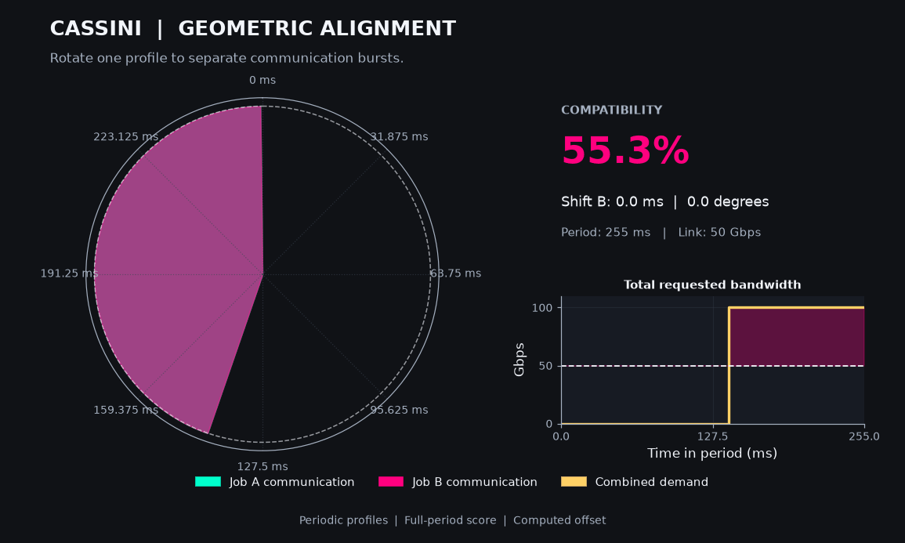
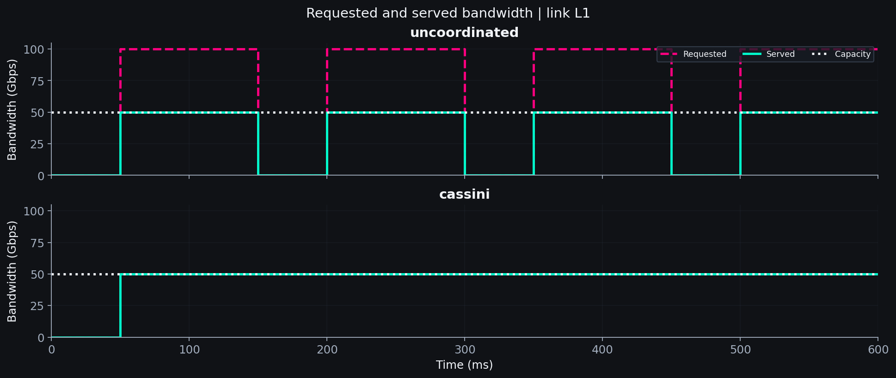
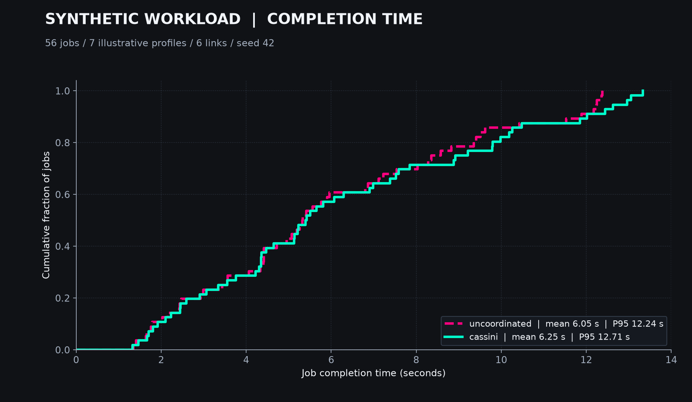
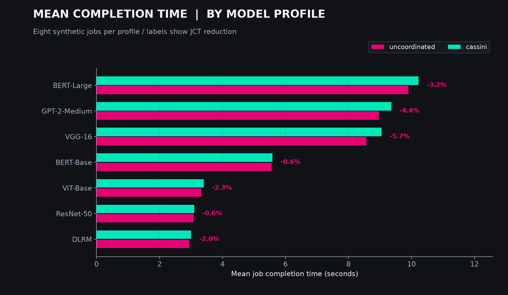
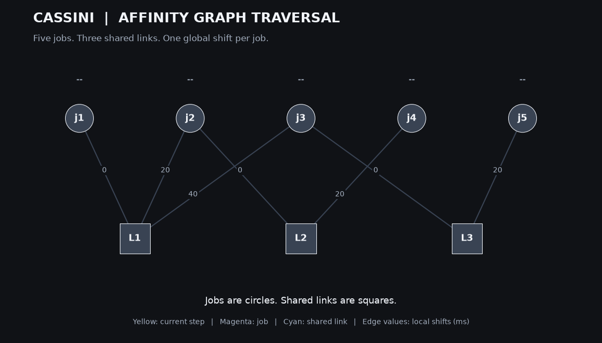
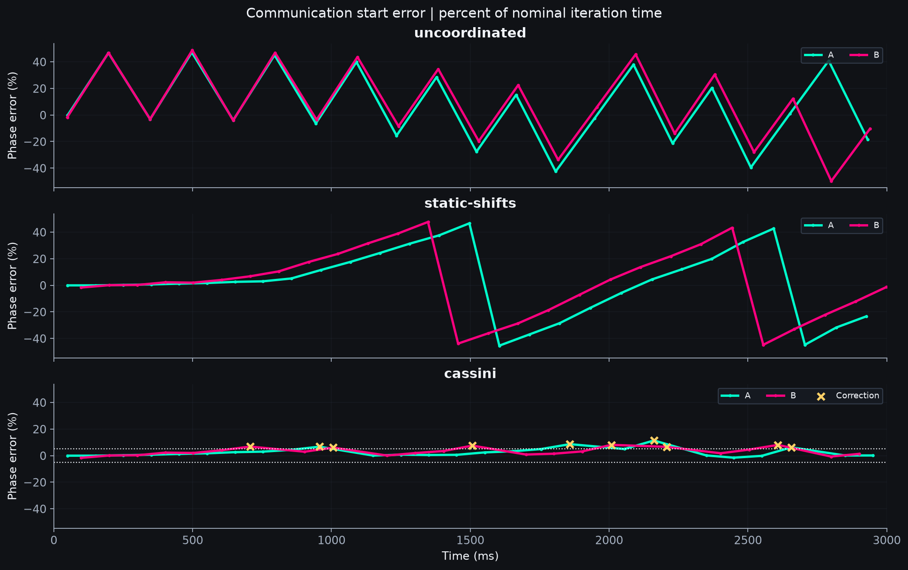

# Cassini simulation

This project tests Cassini's phase scheduling in a Python fluid network model.
It does not require GPUs, switches, or a packet simulator.

The corrected engine executes each phase. It applies time-shifts as waits and
shares bandwidth when transfers overlap. Job completion time (JCT) includes
compute, communication, and all waits.

The animation shows the circular phase-alignment method. One profile stays fixed,
while the other rotates to reduce overlapping communication.



Each profile has 141 ms of compute and 114 ms of communication on a 50 Gbps link.
The solver finds the 114 ms offset shown in the animation. These are periodic
profiles; the animation shows the geometric method, not elapsed training time.

## Start in WSL

Use a WSL terminal and open this project folder. Python 3.10 or later is required.
Create a Linux virtual environment and install the packages:

```bash
python3 -m venv .venv
source .venv/bin/activate
python3 -m pip install -r requirements.txt
```

If Ubuntu cannot create the environment, install its venv package first:

```bash
sudo apt install python3-venv
```

Run the checks, then run the small demo:

```bash
python3 cassini.py test
python3 cassini.py demo
```

The Makefile provides the same entry points:

```bash
make test
make demo
make experiment
make docs
```

Use `python3 cassini.py --help` or `python3 cassini.py demo --help` to see the options.

## Demos and plots

```bash
python3 cassini.py demo --scenario aligned --iterations 10 --solver exact
python3 cassini.py demo --scenario partial --out output/partial
python3 cassini.py demo --scenario multi-link --out output/multi-link
python3 cassini.py demo --scenario dynamic --out output/dynamic
python3 cassini.py demo --jitter 0.04 --include-static --iterations 100 --plot-window 3000 --out output/jitter
```

| Scenario | What it checks |
| --- | --- |
| aligned | Two jobs can alternate communication on one link. |
| partial | Communication demand prevents complete alignment. |
| multi-link | Three jobs share two links. The affinity graph is a chain. |
| dynamic | Jobs arrive while other jobs are running. |

The jitter value `0.04` gives uniform compute variation between -4% and +4%.
Each job receives the same compute samples under every policy.

Each run saves these plots:

| File | Content |
| --- | --- |
| `timeline.png` | Executed compute, communication, and waiting intervals. |
| `bandwidth.png` | Requested bandwidth, served bandwidth, and link capacity. |
| `jct.png` | Completion time distribution and mean waiting time. |
| `drift.png` | Communication start error as a percentage of iteration time. |

Timeline, bandwidth, and drift plots show the first 600 ms by default.
Use `--plot-window 3000` to show more time. Use `--plot-jobs 12` to show more jobs.
These display limits do not change the simulation or the saved event data.
The bandwidth plot uses the same link under every policy.

### Link bandwidth

The aligned runtime demo uses 50 ms of compute and 50 ms of communication per
job, for 10 iterations. Both jobs request the full 50 Gbps link during
communication. Overlapping transfers share its capacity. With the calculated shift, their communication
phases alternate. Served bandwidth stays within capacity in both cases.



### Completion time and waiting cost

The full aligned example gives these results. Completion time includes the
initial phase shift.

| Policy | Mean JCT | Mean wait per job |
| --- | --- | --- |
| Uncoordinated | 1,500 ms | 0 ms |
| Cassini | 1,025 ms | 25 ms |

These values apply only to this synthetic example. They are not results from
Themis, Pollux, or a GPU cluster.

## Rebuild the README visuals

```bash
python3 cassini.py docs
```

This command generates current PNG plots and GIF animations in `visualizations/readme/`.
The geometric and graph examples use the exact grid solver. The larger workload
uses the greedy solver and an explicit scoring window. `manifest.json` records
parameters, results, package versions, and source hashes.

## Experiments and saved data

```bash
python3 cassini.py experiment --jobs 20 --links 4 --iterations 20 --seed 42
python3 cassini.py experiment --catalog --jobs 12 --score-horizon 2000 --out output/catalog
python3 cassini.py experiment --trace data/traces/philly_cluster_trace.json --jobs 10 --score-horizon 2000 --out output/sample
```

The default experiment uses synthetic jobs with simple periodic profiles.
The catalog command uses model parameters with the source limits listed below.
The trace command reads the selected workload file.

`--jobs` limits the number of loaded records. Trace iteration counts stay intact
unless `--iterations` is set. That option overrides the count for every loaded job.

Each run has this layout:

```text
output/<run>/
|-- status.json
|-- plots/                 PNG plots
`-- data/
    |-- summary.csv
    |-- summary.json
    |-- parameters.json
    |-- workload.json
    |-- uncoordinated/     Policy event files and totals
    |-- cassini/
    `-- static-shifts/     Only with --include-static
```

The files have these uses:

- `status.json`: whether the run completed or failed.
- `data/summary.csv` and `data/summary.json`: mean, P50, and P95 JCT; waits; adjustment counts.
- `data/parameters.json`: run options, units, source details, and a workload hash.
- `data/workload.json`: the exact job inputs.
- One folder per policy under `data/`: completions, phase events, link events, drift observations,
  corrections, applied schedule targets, routes, and link totals.

Use a separate `--out` folder to retain each experiment. A repeated run replaces
its generated result files. Output files are excluded from Git.
If that folder uses the previous flat layout, the command also removes its known
old result files. It keeps unrelated files.

Use `--no-history` for large runs. It saves aggregate data and the JCT plot.
The detailed event files and the other plots are omitted.
The engine executes all iterations; it no longer skips them through a score model.
Large workloads can therefore take substantially longer than the old scripts.

## Workload comparison

The following figures use 56 synthetic jobs: eight jobs per catalog profile,
six 50 Gbps links, and seed 42. Routes are fixed before either policy runs.
Arrivals use a 7,000 ms window. Jobs contain 12 to 40 iterations and use no compute jitter.

The scheduler uses the greedy solver and a 2,000 ms scoring window. These plots
show the current simulation with the documented correction rule. They do not
reproduce the paper's hardware results. Catalog source limits still apply.



Each step represents completed jobs. A curve further left has shorter completion
times. In this example, Cassini's alignment and correction waits increase mean
JCT from 6.05 seconds to 7.99 seconds.



The labels show percentage reduction in mean JCT. Negative values mean that
completion took longer. Each comparison uses the same jobs and routes.

## Policies and fair comparison

The comparison uses the same jobs, arrivals, routes, capacities, and noise samples.

- `uncoordinated`: no calculated phase shifts.
- `cassini`: geometric shifts, affinity-graph traversal, and the drift trigger.
- `static-shifts`: the same schedule with drift correction disabled.
  Add `--include-static` to include this comparison.

Routes stay fixed after a job arrives. Unspecified routes use the least occupied
link, with a stable tie rule. Explicit routes can span several links.
This setup isolates phase scheduling. It does not reproduce Themis or Pollux
resource allocation, placement search, or migration.

At an arrival or departure, Cassini calculates a schedule for the active routes.
A new job waits for its target start. An existing job applies the new target at
its next iteration boundary. It can finish its current phase first.
Every applied wait counts towards JCT. A new schedule need not take effect
immediately across all jobs.

### One shift across several links

This example uses five jobs and three shared links. The animation follows the
BFS traversal. Yellow marks the current node or edge. The values above the jobs
show their calculated global shifts.



The edge labels show local shifts in milliseconds. Each job has an 80 ms compute
phase and a 20 ms communication phase. The graph has no cycles.

The network uses max-min bandwidth sharing with a demand cap for each phase.
A transfer must fit the capacity of every link on its path. Compute with no
network demand proceeds independently. Transfer work equals nominal bandwidth
times nominal phase duration, in Gbps ms. Divide that value by eight to obtain MB.

## Drift correction assumption

The supplied paper states that agents measure drift. Section 5.7 gives a trigger:
communication starts differ by more than 5% of the ideal iteration time.

The paper does not give a complete correction procedure. This simulation uses
the following explicit assumption: for a compatible group, an agent delays a
communication phase to its next nominal start when the trigger is exceeded.
It checks phase error modulo the nominal iteration period. The threshold can be
set with `--drift-threshold`. Corrections can cost almost one iteration.
Their cost can exceed the gain from alignment.

This is a model of the existing mechanism, with a stated action rule.
It is not a new research contribution or an exact reproduction of the original agents.

### Drift under compute variation

This run uses 100 iterations per job, uniform compute jitter of +/-4%, and seed 42.
The plot shows the first 3,000 ms. Crosses mark correction triggers. Dotted lines
show the 5% threshold. All panels use the same vertical scale.



In this run, correction gives lower phase error but higher mean JCT than static
shifts. The correction waits have a cost. The settings and full run totals are
saved in [the visual manifest](visualizations/readme/manifest.json).

## Scoring and solver limits

The score follows Table 1: one minus integrated excess bandwidth, divided by
link capacity and the measurement duration. Scores can be negative.

By default, scoring covers the full least common multiple of the job periods.
Fractional phase times are retained. Phase boundaries are integrated directly.
Sampled arrays are used for legacy plots only.

Large common periods can exceed the event budget. The program then stops with
an error. Set `--score-horizon` to request a finite window explicitly.
A score of one in that window does not establish compatibility for all time.

`--resolution` sets the time grid for shift search. The first job is held fixed.
The default `--solver greedy` fixes one later job at a time. It does not guarantee
the global optimum for more than two jobs.

Use `--solver exact` for small validation cases. It checks the joint combinations
of relative grid shifts. A complete search gives the best score on that grid,
with the first job fixed at zero. A score of one permits an early stop.
The exact search rejects more than 20,000 combinations. It never switches to a
heuristic silently. The console and `parameters.json` state the selected solver.
A finite score window still cannot establish periodic compatibility.

The affinity graph must have no cycles. Unsupported cyclic routes are rejected
before optimization. Job IDs and link IDs use separate namespaces. Graph demo
inputs also use a graph with no cycles.

## Data sources

The file names are retained for compatibility. They do not establish a source.

| File | Status |
| --- | --- |
| `philly_2000_jobs.json` | Synthetic; generated locally with seed 42 and a 2.5-hour arrival parameter. |
| `philly_10000_jobs.json` | Synthetic; generated locally with seed 42 and a 12.5-hour arrival parameter. |
| `philly_cluster_trace.json` | Illustrative; no verified mapping to original production records. |
| `real_models.json` | Illustrative parameters, except the source specified for VGG-16. |

The VGG-16 profile uses the 141 ms low-demand phase and 114 ms high-demand phase
from Figure 16 of the supplied paper. Its testbed link rate is 50 Gbps.
Scaling communication time inversely with bandwidth is a simulation assumption.
Other model values lack verified benchmark sources.

## Model boundaries

This is a mathematical testbed. It does not model GPU admission, GPU memory,
training accuracy, switch buffers, packet loss, ECN, PFC, or NCCL internals.
Communication volume is derived from phase time and bandwidth.
The catalog's gradient size and the workload's GPU count do not control execution.

Existing examples show individual geometric and graph concepts.
Use the main utility for current comparisons and plots.

## Reference

Rajasekaran, Ghobadi, and Akella,
*CASSINI: Network-Aware Job Scheduling in Machine Learning Clusters*.
The local reference is arXiv:2308.00852v1, dated 1 August 2023.

## Project layout

```text
.
|-- cassini.py             Main command-line utility
|-- Makefile               Short commands for WSL/Linux
|-- requirements.txt       Python packages
|-- data/
|   |-- models/            Model parameters and source notes
|   `-- traces/            Input workloads and source notes
|-- src/
|   |-- core/              Job, phase, link, and input models
|   |-- math_engine/       Compatibility scores, shifts, and affinity graphs
|   |-- scheduler/         Placement checks and phase simulation
|   `-- visualization/     All plot and animation code
|-- tests/                 Automated checks
|-- examples/              Small examples of individual components
|-- experiments/           Experiment entry points
|-- visualizations/
|   `-- readme/            Current README PNGs, GIFs, and manifest
`-- output/                Local run results; excluded from Git
    `-- <run>/             status.json, data/, and plots/
```

Keep all saved README figures under `visualizations/readme/`. Keep generated run
plots under `output/<run>/plots/`. The plot code is in `src/visualization/`.
The current README animation module replaces the old animation scripts.
Old figures from the previous runtime model are available in Git history.

You can delete `output/` when you no longer need the results. Commands recreate
it. The main utility does not require the scripts in `examples/` or `experiments/`.

## Older entry points

The four cluster experiment scripts now call the main utility. They use the
corrected phase engine and save results under `output/`. Their old penalty and
parallel execution options have been removed. Run a script with `--help` for
current options. Large scripts keep the original iteration counts and can take
considerable time. Use `--jobs 10 --iterations 5` for a quick check.

`experiments/micro_test.py` still shows the circular geometric example.
It now scores phase boundaries and saves its plot under `output/micro/plots/`.
It illustrates Figure 3's method; it does not reproduce a hardware experiment.
