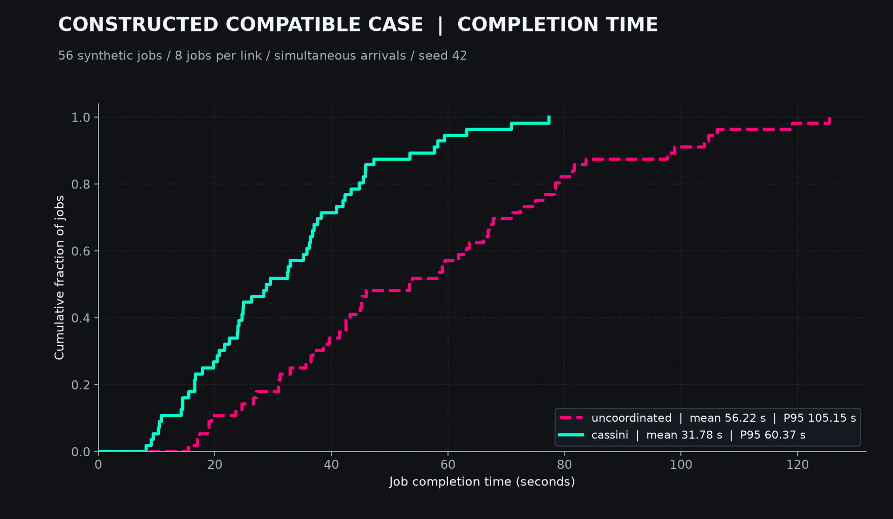
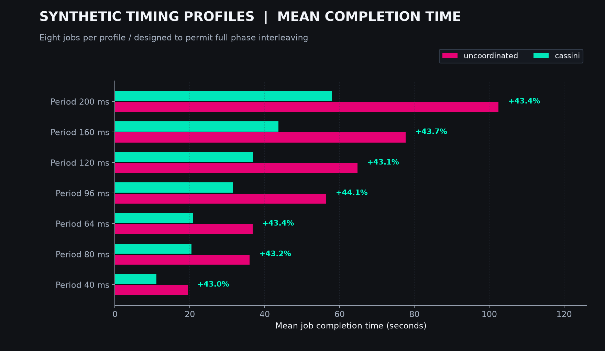
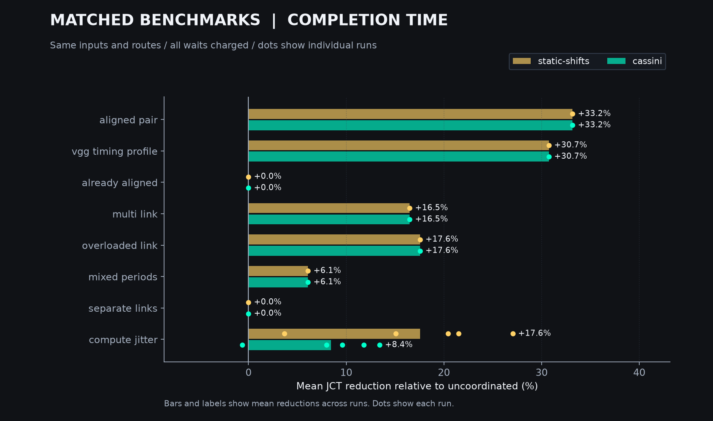

# Cassini simulation

A Python simulator for the phase-scheduling ideas in
[*CASSINI: Network-Aware Job Scheduling in Machine Learning Clusters*](https://www.usenix.org/conference/nsdi24/presentation/rajasekaran).
It models compute phases, bandwidth sharing, and scheduling delays without GPUs
or a packet simulator. A command-line utility runs experiments and produces
plots, event histories, and reproducible input snapshots.

Cassini shifts periodic jobs so their communication phases overlap less:


The animation illustrates the geometric method, not elapsed training time. Each
profile has 141 ms of compute and 114 ms of communication on a 50 Gbps link;
the calculated offset is 114 ms.

**Explore:** [Quick start](#quick-start) · [Results](#results) ·
[How it works](#how-it-works) · [Commands and outputs](#commands-and-outputs) ·
[Data and scope](#data-and-scope)

## Quick start

In a WSL/Linux terminal, open the project folder and use Python 3.10 or later:

```bash
python3 -m venv .venv
source .venv/bin/activate
python3 -m pip install -r requirements.txt

python3 cassini.py test
python3 cassini.py demo
```

On Ubuntu, install `python3-venv` with `sudo apt install python3-venv` if needed.
The demo saves its plots to `output/demo/plots/` and data to `output/demo/data/`.
Use `python3 cassini.py --help` or a subcommand's `--help` to see all options.

| Command | Purpose | Make shortcut |
| --- | --- | --- |
| `python3 cassini.py test` | Run automated checks. | `make test` |
| `python3 cassini.py demo` | Run a small scheduling example. | `make demo` |
| `python3 cassini.py showcase` | Run the constructed compatible workload below. | `make showcase` |
| `python3 cassini.py benchmark` | Compare policies across fixed cases and noise seeds. | `make benchmark` |
| `python3 cassini.py experiment` | Run generated jobs or a workload file. | `make experiment` |
| `python3 cassini.py docs` | Rebuild all README plots and animations. | `make docs` |

## Results

These are results from the fluid simulator, not a reproduction of the paper's
GPU testbed. Every comparison uses identical jobs, arrivals, routes, link
capacities, and compute-noise samples. Job completion time (JCT) includes
compute, communication, initial alignment, and later correction waits.

### Constructed compatible workload

This synthetic workload is deliberately designed to benefit from phase
interleaving. There are **56 jobs on seven 50 Gbps links**, with eight jobs per
link. All jobs arrive together and compute for seven slots before communicating
for one. Cassini can assign the eight transfers separate slots; uncoordinated
jobs request bandwidth at the same time.

```bash
python3 cassini.py showcase
```



| Metric | Uncoordinated | Cassini | Reduction |
| --- | --- | --- | --- |
| Mean JCT | 56.22 s | 31.78 s | **43.47%** |
| P95 JCT | 105.15 s | 60.37 s | **42.59%** |

The seven assumed timing profiles have periods of 40, 64, 80, 96, 120, 160, and
200 ms. Jobs run for 200–400 iterations with seed 42 and no compute jitter.
The default greedy solver uses a 1 ms grid and the full scoring period.
Initial waits average 47.5 ms per job and are included in JCT.
These profiles are constructed inputs, not measurements of ML models or a
datacenter trace.



The simulator validates the results against independent completion-time
formulas, network-work totals, and link-capacity limits. Exact inputs and
results are saved under `output/showcase/`.

### Matched benchmark

The benchmark covers compatible and overloaded links, different periods,
multi-link paths, already aligned arrivals, separate links, and compute jitter.
It includes both static shifts and shifts with drift correction.

```bash
python3 cassini.py benchmark --iterations 100 --seeds 0 1 2 3 4
```



| Case | Uncoordinated mean JCT | Cassini mean JCT | Reduction |
| --- | --- | --- | --- |
| Aligned pair | 15.000 s | 10.025 s | 33.17% |
| VGG timing profile | 36.900 s | 25.557 s | 30.74% |
| Multi-link chain | 12.000 s | 10.020 s | 16.50% |
| Already aligned | 10.000 s | 10.000 s | 0% |
| Separate links | 10.000 s | 10.000 s | 0% |

Deterministic cases run once; the jitter case runs for every supplied seed.
Its bars average the per-seed percentage reductions, and dots show all five
seeds. One seed makes Cassini's mean JCT **0.65% longer**, so correction is not
always beneficial. All cases and results are retained.

The command checks network work, bandwidth limits, matched compute noise, and
elapsed job time. Five cases also have analytical completion-time checks.
Results are saved to `output/benchmark/data/` and the plot to
`output/benchmark/plots/benchmark.png`.

### Mixed-workload stress case

The mixed case uses 56 synthetic jobs across seven illustrative catalog profiles,
six 50 Gbps links, seed 42, arrivals over 7,000 ms, and 12–40 iterations per job.
Routes are fixed before either policy runs. Scheduling uses the greedy solver,
a 2,000 ms scoring window, and no compute jitter.


Here, Cassini's mean JCT is **6.25 s versus 6.05 s** for uncoordinated scheduling:
about **3.3% longer**. Short jobs with mixed periods can lose more time to
alignment and correction than they gain from reduced contention. A finite
scoring window also limits the compatibility calculation.


For the CDF plots, a curve further left means shorter completion times. In the
bar plots, a negative reduction means the policy took longer. Rebuild both
workload comparisons with `python3 cassini.py docs`.

## How it works

### Interleave communication on a shared link

The runtime model executes every phase and shares bandwidth between overlapping
transfers. Each transfer is capped by its requested rate and the capacity of
every link on its path, using max-min sharing.

This two-job example uses 50 ms of compute and 50 ms of communication per
iteration, with each job requesting the full 50 Gbps link:

```bash
python3 cassini.py demo --scenario aligned --iterations 10 --solver exact
```


Without shifts, both jobs share the link at 25 Gbps, giving a mean JCT of
**1,500 ms**. Cassini delays one job by 50 ms so the transfers alternate, giving
a mean JCT of **1,025 ms**, including the average **25 ms** initial wait.
The plot uses the same link and capacity for both policies.

### Coordinate shifts across links

An affinity graph connects jobs to their shared links. Local link schedules
are combined through a breadth-first traversal to assign each job a global shift.


This acyclic example has five jobs, three links, and 80 ms compute / 20 ms
communication profiles. Yellow marks the current traversal step; edge labels
show local shifts and job labels show global shifts, all in milliseconds.

### Handle compute drift

The paper's Section 5.7 describes a trigger when communication starts differ by
more than 5% of the ideal iteration time, but does not specify a complete
correction procedure. **This simulator assumes a delay to the next nominal
communication start**, applied only to compatible groups. Error is measured
modulo the iteration period; `--drift-threshold` changes the trigger.


This example uses 100 iterations, ±4% uniform compute jitter, and seed 42. The
first 3,000 ms are shown on a common vertical scale; crosses mark corrections
and dotted lines mark the 5% threshold. Correction reduces phase error here,
but produces higher mean JCT than static shifts. A correction can cost almost
one iteration, and all such waits count towards JCT.

<details>
<summary><strong>Technical details: policies, scheduling, scoring, and analytical checks</strong></summary>

**Policies and routes.** `uncoordinated` applies no calculated shifts.
`static-shifts` applies geometric shifts without drift correction; enable it
with `--include-static`. `cassini` adds the stated drift rule. Experiments assign
routes once, round-robin in arrival order, before policy execution. Demos specify
their routes directly, including multi-link paths. Routes remain fixed after
admission, and the command verifies that policies use the same saved route map.

**Schedule updates.** An arrival or departure updates only the connected group
whose membership or shared links changed. The oldest incumbent preserves its
reference phase; unchanged phase targets receive no additional alignment wait.
The current arrangement is retained unless the proposed schedule improves the
group's mean compatibility score. New jobs wait for their target start;
existing jobs apply changed targets at their next iteration boundary.

**Compatibility.** Following Table 1 of the paper, the score is one minus
integrated excess bandwidth divided by link capacity and measurement duration.
Scores can be negative. Scoring integrates exact phase boundaries, preserving
fractional times; sampled arrays are only used for profile plots. By default,
the horizon is the full least common multiple of job periods. Exceeding the
event budget produces an error. `--score-horizon` explicitly requests a finite
window, whose score cannot establish compatibility for all time.

**Solvers.** `--resolution` sets the shift-search grid. The default
`--solver greedy` fixes jobs sequentially and does not guarantee a global
optimum for more than two jobs. `--solver exact` searches joint combinations
with the first job fixed at zero, stopping early if it finds a score of one.
It rejects searches above 20,000 combinations rather than silently using a
heuristic. Multi-link scheduling requires an acyclic affinity graph; cyclic
routes are rejected before optimization. Job and link IDs have separate namespaces.

**Aligned-pair check.** For the 50 ms compute / 50 ms communication pair with
`N` iterations, uncoordinated mean JCT is `150 N` ms and Cassini mean JCT is
`100 N + 25` ms. The latter includes the initial wait.

**Constructed-workload check.** Under the showcase conditions, let a job have
`N` iterations, compute duration `c`, communication duration `u`, and initial
slot offset `s`. Its uncoordinated JCT is `N c + u sum_k min(N, N_k)`, where
`N_k` ranges over the iteration counts of all jobs on that link. Cassini JCT
is `N (c + u) + s`. These formulas apply to the constructed synchronized
profiles, not arbitrary workloads.

</details>

## Commands and outputs

Choose a demo with `--scenario aligned`, `partial`, `multi-link`, or `dynamic`.
They cover alternating transfers, incomplete compatibility, a multi-link chain,
and arrivals during execution, respectively.

```bash
# Compute variation, with static shifts included for comparison
python3 cassini.py demo --jitter 0.04 --include-static --iterations 100 --plot-window 3000 --out output/jitter

# Generated periodic jobs
python3 cassini.py experiment --jobs 20 --links 4 --iterations 20 --seed 42

# Catalog profiles or a saved workload
python3 cassini.py experiment --catalog --jobs 12 --score-horizon 2000 --out output/catalog
python3 cassini.py experiment --trace data/traces/philly_cluster_trace.json --jobs 10 --score-horizon 2000 --out output/sample
```

`--jobs` limits loaded records. Trace iteration counts are preserved unless
`--iterations` overrides them. Jitter `0.04` means uniform compute variation
from −4% to +4%, with identical samples under every policy.

Runs save `status.json`, a `data/` directory, and a `plots/` directory under
`output/<command>/`, or the path given by `--out`:

| Output | Contents |
| --- | --- |
| `data/summary.csv`, `summary.json` | Mean, P50, and P95 JCT; waits; correction counts. |
| `data/parameters.json`, `workload.json` | Options, units, provenance, input hashes, and exact jobs. |
| `data/<policy>/` | Completions, phases, link events, drift, corrections, schedules, routes, and totals. |
| `plots/jct.png` | Completion-time distribution and mean waits. |
| `plots/timeline.png` | Executed compute, communication, and waiting intervals. |
| `plots/bandwidth.png` | Requested bandwidth, served bandwidth, and capacity. |
| `plots/drift.png` | Communication-start error relative to the iteration period. |

The benchmark stores raw policy records together in `data/runs.json` and
produces `plots/benchmark.png`. Timeline, bandwidth, and drift plots show the
first 600 ms by default. `--plot-window` and `--plot-jobs` change display limits,
not simulation results or saved events.

Use distinct `--out` paths to retain runs: rerunning replaces known generated
files in that folder while preserving unrelated files. `output/` is excluded
from Git and can be deleted when results are no longer needed. For large runs,
`--no-history` keeps aggregate data and the JCT plot, omitting detailed event
histories and the other plots. Every iteration is still simulated.

<details>
<summary><strong>Larger presets and figure generation</strong></summary>

| Command | Workload |
| --- | --- |
| `make macro-test` | 50 generated jobs on 16 links. |
| `make sample-trace` | 60 illustrative trace records on 16 links. |
| `make large-scale` | 2,000 synthetic trace records on 32 links. |
| `make scale-10k` | 10,000 synthetic trace records on 32 links. |
| `make micro-test` | Standalone circular-profile example in `output/micro/plots/`. |

Trace presets retain the input iteration counts; large runs can take substantial
time. For a quick trial, use `experiment --trace <file> --jobs 10 --iterations 5`.

`python3 cassini.py docs` regenerates all nine README PNGs and GIFs under
`visualizations/readme/`. The geometric and graph examples use the exact grid
solver; the constructed and mixed workloads use the greedy solver. The mixed
workload uses an explicit 2,000 ms scoring window. The
[visual manifest](visualizations/readme/manifest.json) records parameters,
results, package versions, and source hashes.

</details>

## Data and scope

Filenames do not establish provenance. The supplied inputs have these limits:

| File | Provenance |
| --- | --- |
| `data/traces/philly_2000_jobs.json` | Generated locally with seed 42 and a 2.5-hour arrival parameter. |
| `data/traces/philly_10000_jobs.json` | Generated locally with seed 42 and a 12.5-hour arrival parameter. |
| `data/traces/philly_cluster_trace.json` | Illustrative; no verified mapping to production records. |
| `data/models/real_models.json` | Illustrative parameters, except the sourced VGG-16 profile. |

The VGG-16 profile uses the 141 ms low-demand phase and 114 ms high-demand phase
from Figure 16 of the supplied paper, with a 50 Gbps link. Inverse scaling of
communication time with bandwidth is a simulation assumption; other catalog
values lack verified benchmark sources.

This is a mathematical testbed for phase scheduling. It does not implement
Themis/Pollux resource allocation, placement search, migration, GPU admission or
memory constraints, training accuracy, switch buffers, packet loss, ECN, PFC,
or NCCL internals. Communication work is phase duration × requested bandwidth
in Gbps·ms (divide by eight for MB). Catalog gradient sizes and workload GPU
counts do not control execution. The drift action described above is an
explicit modeling assumption, not a verified reproduction of the original agents.

## Project layout

```text
.
├── cassini.py              Command-line entry point
├── Makefile                WSL/Linux shortcuts
├── requirements.txt        Python dependencies
├── data/                   Workloads, model parameters, and source notes
├── src/
│   ├── benchmark.py        Matched cases and analytical checks
│   ├── workloads.py        Constructed synthetic workloads
│   ├── core/               Job, phase, link, and input models
│   ├── math_engine/        Compatibility, shift search, and affinity graphs
│   ├── scheduler/          Phase simulation and schedule application
│   └── visualization/      Plot and animation code
├── tests/                  Automated checks
├── examples/               Standalone component demonstrations
├── visualizations/readme/  Versioned README figures and manifest
└── output/<run>/           Local results: status.json, data/, plots/ (ignored)
```

## Reference

Rajasekaran, Ghobadi, and Akella. *CASSINI: Network-Aware Job Scheduling in
Machine Learning Clusters.* [NSDI 2024](https://www.usenix.org/conference/nsdi24/presentation/rajasekaran).
The supplied local reference is arXiv:2308.00852v1, dated 1 August 2023.
