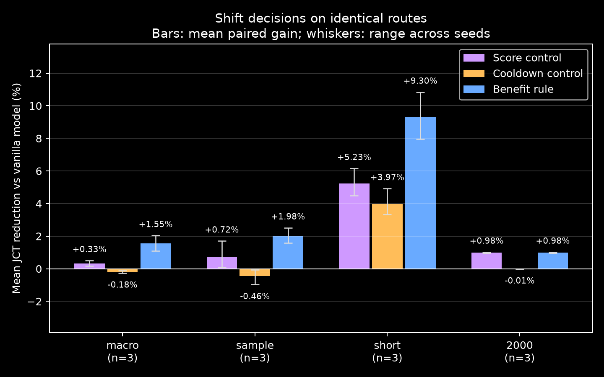
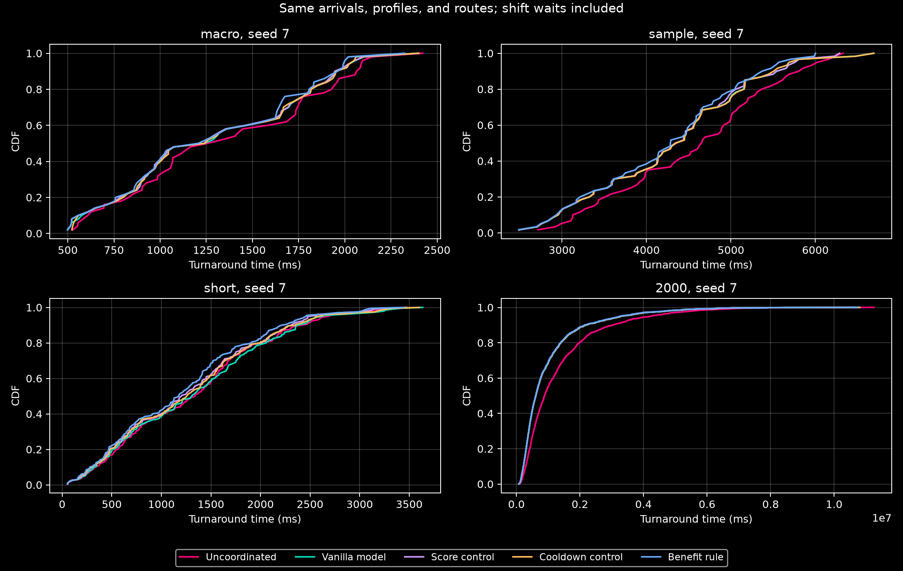

# Shift-Policy Research

This document describes our experiments with shift decision rules for the
Cassini-based fast simulator. For installation, baseline examples, and the
simulator model, see the [project README](README.md).

Our research question is: **When should a proposed communication shift be applied
if the shift itself adds waiting time?** We compare a score check, a cooldown,
and a remaining-work benefit rule against the same vanilla model.

## Versions and workflow

`main` contains the stable Cassini-based fast simulator. The immutable tag
`baseline/fast-runtime-v1` identifies its tested code before the shift-decision
extensions (commit `54e47cd`). It includes shared placement and explicit shift waits.

`research/shift-policies` contains the score control, cooldown control, benefit
rule, and their evaluation. Use this branch for policy development:

```bash
git fetch origin --tags
git switch research/shift-policies
```

To inspect or run the frozen baseline, use `git switch --detach baseline/fast-runtime-v1`.
Return with `git switch research/shift-policies`. Keep changes in small commits,
push each completed change, and merge research into `main` after review and validation.
Saved results retain the source commits that produced them; branch changes do not
change their provenance. Experiment commands and result manifests are documented
with each evaluation below.

## Choosing when to apply a shift

Each acceptance rule has its own module in [`src/scheduler/policies/`](src/scheduler/policies/):
`compatibility.py`, `score.py`, `cooldown.py`, and `benefit.py`. The package registry
selects the rule; the simulator retains shared progress, waiting, and event handling.
The remaining-time estimate is shared through `src/scheduler/shift_policy.py`.

The optional `shift_policy="benefit"` compares keeping the current offsets with
applying Cassini's proposed offsets. It estimates mean remaining completion
time for all affected jobs, including pending and newly added waits. A change
is accepted only if its estimated mean gain exceeds `min_gain_ms` (default 0).
A rejected plan keeps both the current offsets and their recomputed score.
The default `shift_policy="compatibility"` retains the existing Cassini-based
selection rule. Both policies use the same traffic model and wait accounting.

The control policy `shift_policy="cooldown"` accepts changes at most once per
`cooldown_ms` (default 100 ms), per link in incremental mode or across the
cluster in global mode. It is checked at arrival/completion events. The score
control (`shift_policy="score"`) changes offsets only if compatibility strictly
improves, without considering waiting cost. These decision policies require
fixed placement. Completion records include `shift_changes`,
and `Simulator.shift_stats` reports proposed, accepted, and rejected plans.

The score and cooldown controls are comparison methods added in this project,
not policies reported in the Cassini paper. The paper's worker drift correction
uses a timing-error threshold rather than our fixed cooldown interval.

Run all five policies on the same inputs and routes:

```bash
make PYTHON=python3 shift-policy
python3 experiments/shift_policy_experiment.py --workloads macro sample short 2000 --seeds 7 19 42
```

The default command compares uncoordinated scheduling, the vanilla model,
a score control, a cooldown control, and the benefit rule on `macro`, `sample`, and a generated
`short` workload. `--min-gain-ms`, `--cooldown-ms`, `--score-window-ms`, and
`--num-jobs` control the experiment. `--policies` selects a subset that includes
`compatibility`. Stored traces use the seed for placement;
`macro` and `short` also use it to generate jobs. The `short` case has 200 jobs,
4 links, exponential arrivals with mean 8 ms, and 1 to 5 iterations per job.

Raw completion records go to `output/shift-policy/`. Two plots and a settings,
source, and results manifest go to `visualizations/` with the `shift_policy_`
prefix. Other experiment figures are preserved. Use `--output-dir` and
`--plot-dir` for separate runs. Bar whiskers show the range across seeds, not
a confidence interval; labels report the mean and whiskers show both ends
of that range. CDFs use the first requested seed. The manifest also
reports waiting, shift counts, and whole-simulation wall time.
New manifests hash every policy module as well as the shared simulator sources.
Existing published manifests retain their original source commits and hashes.

## Workloads and metrics

All comparisons use the same jobs and fixed job-to-link placement for every
policy in a paired run. Link capacity is 50 Gbps, the runtime penalty is 1.5,
and the scoring window limit is 600 ms with 1 ms samples.

| Workload | Jobs | Links | Input and purpose |
| --- | ---: | ---: | --- |
| `macro` | 50 | 16 | Generated jobs with 5 to 25 iterations and varied phase durations. |
| `sample` | 60 | 16 | Illustrative `data/traces/philly_cluster_trace.json`, using seven model profiles. |
| `short` | 200 | 4 | Generated jobs with 1 to 5 iterations; tests the cost of waiting when little work remains. |
| `2000` | 2,000 | 32 | Stored synthetic trace, generated with seed 42 and a 2.5-hour arrival parameter. |
| `10000` | 10,000 | 32 | Stored synthetic trace, generated with seed 42 and a 12.5-hour arrival parameter. |

The stored traces are synthetic or illustrative, not verified production
records. `macro` and `sample` use global scoring; `short`, `2000`, and `10000`
use per-link incremental scoring. The sample profiles use 25 Gbps bandwidth;
the two large workloads use 50 Gbps.

| Metric | Meaning |
| --- | --- |
| Mean JCT | Average time from arrival to completion, including shift waits. |
| P95 JCT | Completion-time threshold met by 95% of jobs. |
| Mean shift wait | Average accumulated shift wait per job. |
| Shift changes | Total nonzero offset changes across jobs. |
| Simulator wall time | Computer time needed to run the simulation; separate from simulated JCT. |

JCT reduction is `100 * (vanilla JCT - policy JCT) / vanilla JCT`. Positive
values mean faster completion. Reported mean reductions average the paired
percentage for each seed. Fewer changes or less waiting alone do not guarantee
lower JCT.

## Results

All values below are percentage reductions in mean JCT relative to the vanilla
model, averaged over paired seeds. Settings are a 0 ms minimum gain and a
100 ms cooldown. The 50-job, 60-job, short-job, and 2,000-job cases use seeds
7, 19, and 42. The 10,000-job case uses seed 42 only. A seed changes placement
for stored traces, and also changes jobs for generated workloads.

| Workload | Seeds | Score control | Cooldown control | Benefit rule (range) |
| --- | ---: | ---: | ---: | ---: |
| 50 generated jobs | 3 | +0.33% | -0.183% | +1.55% (+1.09 to +2.04) |
| 60 illustrative jobs | 3 | +0.72% | -0.456% | +1.98% (+1.58 to +2.51) |
| 200 short synthetic jobs | 3 | +5.23% | +3.974% | +9.30% (+7.95 to +10.84) |
| 2,000 synthetic jobs | 3 | +0.98% | -0.005% | +0.98% (+0.94 to +1.02) |
| 10,000 synthetic jobs | 1 | +3.11% | -0.003% | +3.11% |

<p align="center">
  
  
</p>

The benefit rule exceeds both simple controls on all three seeds of the smaller
workloads. On the 2,000- and 10,000-job cases, it gives the same results as the
score control: these gains do not establish an extra benefit from the waiting
cost test. The evidence for that extra benefit is concentrated in short jobs.
The method minimizes an estimate of the mean; it does not guarantee an
improvement for every individual job.

The 10,000-job simulation took 61.09 s for the vanilla model and 64.77 s
for the benefit rule. These are simulator wall times, separate from simulated
job completion times. The fast event runtime is used for all policies.

The [main results](visualizations/shift_policy_results.json) and
[10,000-job results](visualizations/shift_policy_scale/shift_policy_results.json)
include P95 JCT, waiting costs, shift counts, and per-policy runtimes. The
10,000-job [gain plot](visualizations/shift_policy_scale/shift_policy_comparison.png)
and [CDF](visualizations/shift_policy_scale/shift_policy_cdf.png) are also available.

A sensitivity run uses a 5 ms minimum gain and a 500 ms cooldown on the three
smaller workloads, with the same three seeds:

| Workload | Cooldown control | Benefit rule |
| --- | ---: | ---: |
| 50 generated jobs | -1.05% | +1.45% |
| 60 illustrative jobs | -1.72% | +2.00% |
| 200 short synthetic jobs | +7.16% | +9.90% |

The [sensitivity records](visualizations/shift_policy_sensitivity.json) contain
all runs. These results are model experiments on a small set of seeds, rather
than proof of a general improvement or novelty. Remaining-work prediction
errors and an independent execution model have not been evaluated here.

Reproduce these evaluations:

```bash
python3 experiments/shift_policy_experiment.py --workloads macro sample short 2000 --seeds 7 19 42
python3 experiments/shift_policy_experiment.py --workloads 10000 --seeds 42 --output-dir output/shift-policy-scale --plot-dir visualizations/shift_policy_scale
python3 experiments/shift_policy_experiment.py --workloads macro sample short --seeds 7 19 42 --min-gain-ms 5 --cooldown-ms 500 --output-dir output/shift-policy-sensitivity --plot-dir output/shift-policy-sensitivity/plots
```

The estimate holds current scores fixed over the remaining work. It uses
known remaining iterations in this model, does not inspect future arrivals,
and does not predict departures or profile uncertainty. It is a prototype
extension, with no guarantee of lower actual JCT on every workload.

The design draws on [Eclipse](https://people.csail.mit.edu/alizadeh/papers/eclipse-sigmetrics16.pdf)
and [adaptive scheduling with reconfiguration delay](https://arxiv.org/html/1511.03417),
which weigh schedule benefits against change costs. Their guarantees do not
transfer to this model. The comparison baseline is our Cassini-based model,
not the paper's full implementation with worker-level drift correction.

## Remaining-work estimate errors

`--remaining-work-scale` multiplies the remaining-work estimate supplied to the
benefit rule. For example, `0.5` means 50% too low and `1.5` means 50% too high.
The default `1.0` retains the original rule. The simulator's actual job lengths,
progress, traffic profiles, placement, and shift-wait accounting are unchanged.
The other policies ignore this estimate setting.

This is a controlled test of a systematic multiplicative error at every decision,
not a learned job-length predictor. The estimate still uses true remaining work
before applying the multiplier; it does not model missing progress information.

Run a single error setting without replacing the published figures:

```bash
python3 experiments/shift_policy_experiment.py --workloads short --seeds 7 19 42 --policies compatibility benefit --remaining-work-scale 0.5 --output-dir output/remaining-work-low --plot-dir output/remaining-work-low/plots
```

## Possible future experiments

Future work can compare this simplified model with additional baseline policies:

### 1. Priority & Least-Attained-Service (LAS) Schedulers (Tiresias / Themis)
- **Concept**: Implement a 2D-Gittins index or Least Remaining Time First (SRTF) heuristic that preemptively schedules short ML jobs ahead of long jobs.
- **Goal**: Measure how much of CASSINI's speedup is orthogonal to priority scheduling. In theory, CASSINI can be integrated *on top* of Tiresias to interleave phases among prioritized co-runners.

### 2. Randomized / Staggered Offset Baseline (Ablation Study)
- **Concept**: A naive baseline that applies an arbitrary uniform random phase shift $\tau_i \sim \text{Uniform}(0, T_i)$ to arriving jobs rather than solving the geometric LCM circular alignment problem.
- **Goal**: Disentangle the benefit of *deliberate geometric non-collision* from *statistical de-synchronization*.

### 3. Traffic-Pacing & Bandwidth-Partitioning Schedulers (Gandiva / AlloX)
- **Concept**: Rather than time-multiplexing communication bursts, partition link capacity evenly ($C / k$) or pace NCCL flows using rate limiters.
- **Goal**: Quantify the trade-off between constant bandwidth throttling vs. CASSINI's full line-rate burst interleaving.

### 4. Packet-Level Discrete-Event Simulator Integration (ns-3 / Astra-sim / htsim)
- **Concept**: Bridge the high-level Python mathematical simulator with packet-level network simulators to model Priority Flow Control (PFC), RoCEv2 Explicit Congestion Notification (ECN), and switch buffer drops directly.
- **Goal**: Check whether sampled overlap reductions persist under packet jitter and transport-layer queueing.
